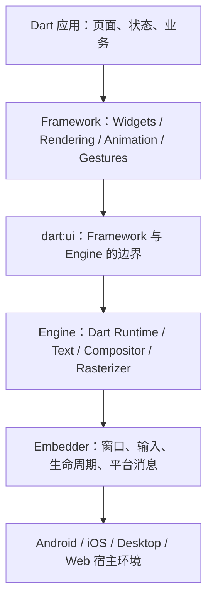
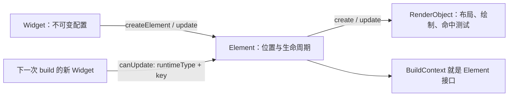
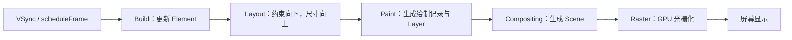
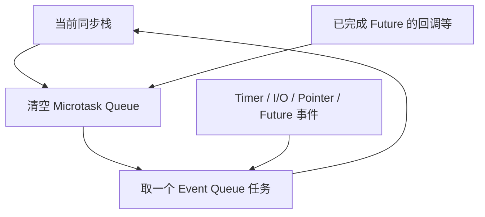
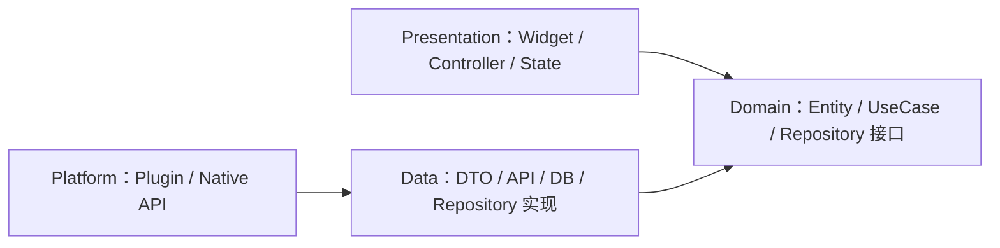

import Mermaid from '../../components/mermaid';

# Flutter 原理与中高级面试手册

> 目标：不仅会使用 Widget，还能解释 Flutter 如何把状态变成屏幕上的像素，并能用工程化方法定位性能、架构与跨端问题。
>
> 版本说明：本文描述稳定的框架抽象。渲染后端、线程归属等实现会随 Flutter 版本和平台变化；涉及这些内容时，应以当前 Flutter 官方文档和目标设备实测为准。

## 1. 一张图建立 Flutter 知识地图

Flutter 不是把系统原生控件简单包装一层。通常情况下，它由 Framework 组织 UI 和生成 Scene，由 Engine 完成文字排版、合成与光栅化，再由 Embedder 接入操作系统的窗口、输入、生命周期和平台服务。

<Mermaid>

</Mermaid>

| 层级 | 主要职责 | 面试关键词 |
| --- | --- | --- |
| Dart App | 业务、状态、Widget 组合 | 声明式 UI、不可变配置 |
| Framework | 构建、布局、绘制、手势、动画 | Widget/Element/RenderObject |
| Engine | 场景合成、光栅化、文本、Dart 运行时 | Impeller、Raster、`dart:ui` |
| Embedder | 对接平台窗口、输入、线程、生命周期 | Platform Channel、View、Activity/UIViewController |

Flutter 的声明式 UI 可以概括为：

```dart
UI = f(state)
```

状态变化后，开发者描述“现在应该是什么样”，Framework 负责复用长期存在的对象，并把差异传播到布局、绘制和合成阶段。`build()` 可能被频繁调用，因此应当快速、幂等且没有业务副作用。

### 面试题：Flutter 为什么能跨平台且保持较一致的 UI？

- **结论**：Framework 维护自己的 UI/渲染模型，Engine 在不同平台使用统一的场景描述完成光栅化，Embedder 负责平台接入，因此大部分 UI 行为不依赖系统控件版本。
- **原理**：Dart 代码构造 Widget，Framework 更新 Element 与 RenderObject，最后生成 Scene 交给 Engine；平台只提供窗口、GPU surface、输入和系统服务。
- **实践**：文本输入、WebView、地图、相机预览等仍可能依赖原生视图或插件，要处理平台差异。
- **追问**：Flutter Web 运行在浏览器约束下，渲染与并发能力不能直接套用移动端结论。

### 面试题：Flutter 与 React Native 的核心差异是什么？

- **结论**：二者都是声明式跨端方案，但 Flutter 通常自带渲染体系；React Native 主要把 React 模型接到原生平台视图和能力上。
- **原理**：差异会影响 UI 一致性、原生控件复用、包体积、调试方式以及新平台特性的接入成本。
- **实践**：选型不能只看跑分，应同时比较团队语言栈、原生依赖、动态化需求、复杂动画和长期维护成本。
- **追问**：不要把“Flutter 完全不使用原生能力”当作答案，系统服务、插件和 Platform View 都依赖平台。

## 2. Widget、Element、RenderObject 三棵树

这是 Flutter 原理面试的主线。

<Mermaid>

</Mermaid>

### 2.1 Widget：轻量、不可变的配置

- Widget 描述 UI 的配置，不是屏幕上的实体，也通常不保存可变状态。
- `StatelessWidget` 的配置变化来自父级；`StatefulWidget` 把可变生命周期交给独立的 `State`。
- 创建 Widget 对象通常很便宜，真正应关注的是昂贵计算、过大的更新范围、重复布局和绘制。

### 2.2 Element：把两次 build 连接起来

- Element 表示某个 Widget 在树中的具体位置，并跨帧存在。
- Element 持有当前 Widget，并负责挂载、更新、失活和卸载。
- `BuildContext` 本质上是 Element 暴露出的接口，所以它代表“树中的位置”，不是全局上下文。
- `Theme.of(context)`、`MediaQuery.of(context)` 等会沿 Element 的祖先关系寻找 `InheritedWidget`。

### 2.3 RenderObject：真正参与渲染

- RenderObject 处理约束、尺寸、位置、绘制、命中测试和语义信息。
- 不是每个 Widget 都有独立 RenderObject。组合型 Widget 可能只产生 `ComponentElement`；最终由 `RenderObjectWidget` 对接 RenderObject。
- `RenderBox` 使用二维盒约束模型；Sliver 则面向滚动视口使用另一套约束协议。

### 2.4 更新与复用

父节点给同一位置提供新 Widget 后，Framework 主要通过以下条件判断旧 Element 能否更新：

```dart
static bool canUpdate(Widget oldWidget, Widget newWidget) {
  return oldWidget.runtimeType == newWidget.runtimeType &&
      oldWidget.key == newWidget.key;
}
```

能更新就保留 Element/State 并替换配置；不能更新则移除旧子树并创建新子树。这里不是对整棵 Widget 树做通用的深度 diff。

### 面试题：Widget 每次都重建，为什么性能仍然可以很好？

- **结论**：重建的主要是轻量配置对象；Element 和 RenderObject 会按类型与 Key 尽量复用，且只有被标脏的区域进入相应流水线。
- **原理**：Element 把前后两次 Widget 配置连接起来，更新可以只传播到需要重建、布局或绘制的节点。
- **实践**：优化前先在 profile 模式测量；不要为了减少 Widget 对象而写晦涩缓存。
- **追问**：build 便宜不等于可以在其中同步解析大 JSON、访问磁盘或反复创建昂贵资源。

### 面试题：BuildContext 为什么可能在异步操作后失效？

- **结论**：Context 代表 Element 的位置；等待期间页面可能已被卸载，后续再查祖先或导航就不安全。
- **实践**：异步间隙后检查 `context.mounted` 或 `State.mounted`，并在使用前再次确认业务状态。

```dart
Future<void> save(BuildContext context) async {
  await repository.save();
  if (!context.mounted) return;
  Navigator.of(context).pop();
}
```

## 3. Key、生命周期与依赖更新

### 3.1 Key 到底解决什么问题

Key 用来给同一父节点下的子节点建立身份。没有 Key 时通常按位置和类型复用；列表发生插入、删除、换序时，这可能让 State 跟错数据。

| Key | 典型用途 | 注意点 |
| --- | --- | --- |
| `ValueKey` | 用业务 id 标识列表项 | 最常用，值需稳定 |
| `ObjectKey` | 用对象身份标识 | 依赖对象相等性 |
| `UniqueKey` | 强制每次成为新身份 | 会放弃复用 |
| `GlobalKey` | 跨父节点移动 State、访问 State/Context | 成本高，避免滥用 |

### 3.2 StatefulWidget 生命周期

常见顺序：

1. `createState()`：创建 State。
2. `initState()`：一次性初始化；不能在这里依赖尚未建立完成的 inherited dependency。
3. `didChangeDependencies()`：依赖的 `InheritedWidget` 变化时调用，首次构建前也会调用。
4. `build()`：生成当前配置。
5. `didUpdateWidget()`：同位置、同类型和 Key 的新 Widget 更新旧 State。
6. `deactivate()`：暂时离开树，仍可能被重新插入。
7. `dispose()`：永久卸载，释放 controller、监听器、订阅等。

```dart
class _ProfileState extends State<Profile> {
  late final TextEditingController controller;

  @override
  void initState() {
    super.initState();
    controller = TextEditingController(text: widget.initialName);
  }

  @override
  void didUpdateWidget(covariant Profile oldWidget) {
    super.didUpdateWidget(oldWidget);
    if (oldWidget.initialName != widget.initialName) {
      controller.text = widget.initialName;
    }
  }

  @override
  void dispose() {
    controller.dispose();
    super.dispose();
  }
}
```

### 面试题：`GlobalKey` 为什么不能作为默认方案？

- **结论**：它提供全局唯一身份和跨位置重挂载能力，但会扩大框架维护成本并增加耦合。
- **实践**：表单校验、需要跨父节点保留 State 等明确场景再使用；普通列表优先 `ValueKey`，父子通信优先参数和回调。
- **追问**：每次 build 新建 `GlobalKey` 会丢失原有身份和 State。

## 4. 从约束到像素：渲染流水线

<Mermaid>

</Mermaid>

### 4.1 布局：Constraints go down, sizes go up

在 RenderBox 模型中：

1. 父节点向子节点传递 `BoxConstraints`。
2. 子节点必须在约束范围内选择自己的 Size。
3. 父节点根据子节点尺寸决定位置，并最终确定自身尺寸。

因此“父节点设置位置，子节点决定尺寸”只是一种便于记忆的概括，准确说法是：父传约束、子报尺寸、父定位置。`Unbounded height` 往往来自滚动方向上的无限约束与要求确定尺寸的子节点发生冲突。

```dart
LayoutBuilder(
  builder: (context, constraints) {
    return constraints.maxWidth < 600
        ? const CompactPage()
        : const WidePage();
  },
)
```

### 4.2 Paint、Layer 与 `RepaintBoundary`

- Paint 把绘制指令记录到 Layer/Display List 等结构中，并不等于立即逐像素绘制到屏幕。
- 合成阶段组合图层并生成 Scene，Engine 再完成光栅化。
- `RepaintBoundary` 可以形成独立绘制边界，使一侧变脏时另一侧复用已有结果；但边界过多会增加图层、内存和合成成本。

### 4.3 `setState()` 做了什么

`setState()` 同步执行回调，然后把对应 Element 标记为需要重建并安排一帧。它不会立即把整个 App 重新绘制，也不应接收 `async` 回调。

```dart
setState(() {
  count += 1; // 只做同步状态变更
});
```

重建、重新布局、重绘是三个不同维度：Widget 更新不一定触发布局；布局变化不一定要求所有兄弟重绘；动画也可能只改变合成属性。

### 面试题：`RepaintBoundary` 是否越多越好？

- **结论**：不是。它用额外图层和缓存机会换取绘制隔离。
- **实践**：适合复杂但稳定的子树与频繁变化区域相邻的场景；用 DevTools 的 repaint rainbow 和时间线验证收益。
- **追问**：它隔离的是 paint，不会阻止 build，也不自动阻止 layout。

### 面试题：为什么不要用 debug 模式判断卡顿？

- **结论**：debug 包含断言、调试服务和不同的编译策略，性能不代表发布结果。
- **实践**：真机 profile 模式复现，结合 UI/Raster 时间线、帧图和 CPU profiler 定位。

## 5. 帧调度、动画、命中测试与手势

### 5.1 Scheduler 与一帧

状态变更或动画会请求新帧，平台 VSync 到达后，Scheduler 驱动瞬时回调、build/layout/paint 和帧后回调。60 Hz 屏幕理论帧预算约为 16.67 ms，120 Hz 约为 8.33 ms；实际应依据设备刷新率和工具指标，而不是死记一个预算。

- `addPostFrameCallback`：当前帧结束后执行一次，适合读取已完成布局的信息；它本身通常不会请求新帧。
- `scheduleFrameCallback`：注册下一帧开始阶段的回调。
- `Ticker`：在启用的帧中提供时间信号，`AnimationController` 基于它推进动画。

### 5.2 命中测试与手势竞技场

指针事件先对 RenderObject 树做 hit test，得到从目标到祖先的路径，再分发原始事件。多个 GestureRecognizer 可能同时对同一指针序列感兴趣，它们进入 Gesture Arena，最终由规则决定胜者。

- `Listener`：监听原始 pointer down/move/up 等事件。
- `GestureDetector`：把原始序列识别成 tap、drag、scale 等语义手势。
- `HitTestBehavior`：控制透明区域是否参与命中测试，但不等于无条件阻断所有祖先手势。

### 面试题：点击事件为什么会冲突？如何排查？

- **结论**：多个识别器可能竞争同一指针序列，最终只有符合竞技场规则的识别器获胜。
- **实践**：先确认命中区域，再区分原始事件和语义手势，检查嵌套滚动、横纵拖拽方向以及透明层的 behavior。
- **追问**：Flutter 手势竞争不能简单等同于 Web DOM 的冒泡/捕获模型。

## 6. Dart 运行时：事件循环、Future 与 Isolate

### 6.1 一个 Isolate，一个事件循环

每个 Isolate 有独立内存和自己的事件循环。普通 Dart 代码在某个 Isolate 中串行执行；`async/await` 让等待期间可以处理其他事件，但不会自动把 CPU 密集计算放到另一个核心。

<Mermaid>

</Mermaid>

微任务会在下一个事件前被清空；连续制造微任务可能饿死事件队列，导致输入和绘制得不到处理。面试时不要绝对化所有 `Future` 的入队位置，应结合 Future 的创建方式和完成时机说明。

```dart
void main() {
  print('A');
  scheduleMicrotask(() => print('microtask'));
  Future(() => print('event'));
  print('B');
}
// A, B, microtask, event
```

### 6.2 `async/await` 的本质

- `async` 函数立即返回 Future。
- 执行到未完成 Future 的 `await` 时，当前函数让出执行权；Future 完成后继续后半段。
- `await` 解决的是非阻塞等待和代码可读性，不等于并行。
- 多个互不依赖的异步 I/O 可先创建 Future，再使用 `Future.wait` 并发等待。

### 6.3 Isolate：隔离内存的并行单元

CPU 密集任务可使用 `Isolate.run` 或长期 Isolate，双方通过消息通信，不共享普通可变对象。

```dart
import 'dart:isolate';

Future<int> parseInBackground(List<int> bytes) {
  return Isolate.run(() => expensiveParse(bytes));
}
```

创建 Isolate、复制或传输消息都有成本。短小计算放过去可能更慢；插件调用还需确认后台 Isolate 支持和初始化方式。Dart Web 的并发能力与 Native 不同，不能直接假设移动端 Isolate 行为。

### 6.4 JIT、AOT 与开发体验

- 开发阶段使用支持 JIT 的运行方式，便于 hot reload 和调试。
- 移动端 release 通常采用 AOT，把 Dart 编译为目标平台机器码，提升启动和稳定执行性能。
- Hot reload 尽量保留 State 并重新执行相关 build；Hot restart 重启 Dart 隔离区，状态丢失；完整 restart 还会重启原生宿主。

### 6.5 空安全、GC 与内存泄漏

健全空安全把 nullable 与 non-nullable 类型分开，减少空引用错误；`late` 把检查推迟到运行时，滥用会把编译期保障变成运行时异常。

Dart VM 使用垃圾回收管理不可达对象，但“有引用却不再需要”的对象仍会泄漏，例如：

- 未取消的 Stream/事件订阅；
- 未释放的 `AnimationController`、`TextEditingController`；
- Timer、闭包或单例意外持有页面 State/Context；
- 无上限缓存和大图片；
- 原生插件资源未释放。

### 面试题：Future 能解决大 JSON 解析导致的掉帧吗？

- **结论**：仅把同步解析包进 Future 通常仍在当前 Isolate 执行，不能消除 CPU 阻塞。
- **实践**：测量后把足够重的纯计算交给 `Isolate.run`/`compute`，控制消息大小，并考虑增量解析。
- **追问**：网络请求本身通常是异步 I/O，不必为了“异步”再创建 Isolate。

### 面试题：Isolate 和线程有什么区别？

- **结论**：Isolate 是 Dart 的并发隔离单元，拥有独立堆和事件循环，以消息通信；它不是共享内存线程的直接包装概念。
- **原理**：隔离减少锁和数据竞争，但不能消除业务层的时序竞争。
- **追问**：Engine/Embedder 内部仍会使用平台线程，不能由“Dart Isolate 不共享内存”推导出整个 Flutter 进程只有一个线程。

## 7. 状态管理：先分状态，再选工具

状态可按生命周期与共享范围划分：

- 瞬时 UI 状态：展开、选中、动画进度，通常放在局部 State。
- 页面状态：加载、成功、空、失败及页面数据。
- 跨页面应用状态：登录态、主题、购物车。
- 服务端状态：有缓存、失效、重试和并发一致性问题。

| 方案 | 核心模型 | 适用场景 | 主要代价 |
| --- | --- | --- | --- |
| `setState` / `ValueNotifier` | 局部可变状态与监听 | 小范围、简单页面 | 跨层共享困难 |
| Provider | 基于 Inherited 依赖注入与监听 | 中小项目、渐进改造 | 复杂依赖需规范 |
| Riverpod | 容器化 provider、可组合依赖 | 可测试的中大型项目 | 学习和建模成本 |
| BLoC/Cubit | 事件/方法到状态流 | 状态机明确、多人协作 | 模板代码与抽象成本 |

`InheritedWidget` 的关键不是“全局变量”，而是让依赖者登记对祖先数据的依赖；当值变化时，只通知登记过的 Element。成熟方案通常还提供选择性监听、生命周期、依赖组合和测试能力。

### 面试题：如何选择状态管理方案？

- **结论**：按状态复杂度、团队约束、可测试性和依赖关系选，不按流行度选。
- **实践**：局部状态不提升；异步页面统一建模 loading/data/error；跨模块状态规定所有权和写入入口；使用 selector 缩小更新范围。
- **追问**：状态管理不能替代领域分层，也不能自动解决缓存一致性。

## 8. 路由、架构与依赖注入

### 8.1 路由

- Navigator 维护 Route 栈，`push` 返回的 Future 在页面 `pop(result)` 后完成。
- 声明式路由根据应用状态生成页面集合，更适合深链、Web URL、登录重定向和多 Navigator 场景。
- 路由参数应可序列化并可恢复；不要只依赖内存对象，否则冷启动深链无法还原页面。
- 多 Tab 保持各自返回栈时，通常需要嵌套 Navigator，并明确系统返回键策略。

### 8.2 推荐的依赖方向

<Mermaid>

</Mermaid>

- Presentation 负责展示与交互状态，不直接拼接数据库或 HTTP 细节。
- Domain 表达业务规则，不依赖 Flutter UI。
- Data 处理序列化、远端/本地数据源与缓存策略。
- 依赖注入负责对象创建和替换，不应退化为可随意访问的 Service Locator。

### 面试题：Clean Architecture 是否层数越多越好？

- **结论**：不是。边界的价值是隔离变化和便于测试，层数应匹配复杂度。
- **实践**：小功能可以纵向切片并减少样板；跨数据源、规则复杂或多人维护的模块再引入明确 UseCase 和 Repository 接口。

## 9. 网络、缓存与本地存储

### 9.1 网络层应该解决什么

- 超时、取消、重试和退避；只对幂等或具备幂等键的请求安全重试。
- 统一认证刷新，避免多个 401 同时触发并发刷新。
- 错误分层：网络不可达、超时、协议错误、业务错误、解析错误。
- 日志脱敏，不记录 token、密码和敏感个人数据。
- DTO 与领域对象分离，后端字段变化不要直接污染 UI。

### 9.2 缓存策略

先定义一致性语义，再选存储工具：

- Cache-first：先读缓存，再后台刷新，体验快但可能短暂过期。
- Network-first：先请求，失败回退缓存，数据较新但首屏依赖网络。
- Stale-while-revalidate：立即展示旧值并刷新，需处理新旧数据切换。
- 离线写入：需要本地操作日志、冲突策略、重试和幂等设计。

敏感凭证使用系统安全存储；偏好设置适合小型配置；结构化、可查询且数据量较大的内容使用数据库。不要把“持久化”与“缓存”混为一谈：缓存可以丢，业务数据通常不能。

### 面试题：如何设计 token 无感刷新？

- **结论**：用单飞机制保证同一时刻只有一个刷新请求，其他失败请求等待结果后重放。
- **实践**：刷新失败统一退出登录；限制重放次数；请求体不可重放时单独处理；刷新凭证放安全存储；全链路避免死循环。

## 10. Platform Channel、插件与混合开发

### 10.1 平台通信方式

| 通道 | 适用场景 |
| --- | --- |
| `MethodChannel` | Dart 调原生方法并取得单次结果 |
| `EventChannel` | 原生向 Dart 持续发送事件流 |
| `BasicMessageChannel` | 双向消息传递、自定义 codec |
| FFI | 直接调用 C ABI 的高性能库，不等于调用任意 Java/Kotlin/Swift API |

标准 Channel 的消息需要编码、跨边界和调度，不适合高频大数据逐帧传输。接口应定义版本、错误码、超时、线程要求和生命周期。类型安全需求较高时可使用代码生成式消息接口。

### 10.2 Platform View

地图、WebView 等原生 View 可嵌入 Flutter，但它们与 Flutter 自绘内容来自不同渲染体系，可能增加合成、手势、裁剪和无障碍处理复杂度。Android 的不同组合模式在性能、变换和兼容性上有取舍，应按插件和当前平台文档选择。

### 10.3 Add-to-App

混合工程需额外考虑：

- FlutterEngine 的预热、缓存和销毁；
- 路由与返回键归属；
- 原生与 Dart 生命周期同步；
- 多 Engine 的内存、插件注册和状态隔离；
- 构建产物、依赖版本与 CI 集成。

### 面试题：Platform Channel 会阻塞 UI 吗？

- **结论**：调用形式可以异步返回，但消息编解码、Dart 回调以及原生处理放在哪个线程仍决定是否卡顿。
- **实践**：原生重任务放合适的后台执行环境，结果回到规定线程；避免大对象高频传输；用 trace 实测两侧耗时。
- **版本提示**：移动端线程归属近年发生过架构调整，不应背诵固定的旧线程数量；回答应聚焦职责并结合当前版本文档。

## 11. 性能诊断与优化

### 11.1 先判断卡在哪个阶段

1. 用真机 profile 模式稳定复现，记录设备、系统和操作路径。
2. 查看 DevTools Performance 的帧图与 Timeline。
3. UI/Dart 执行时间高：查同步计算、频繁 rebuild、GC、消息处理。
4. Raster/GPU 时间高：查过度绘制、`saveLayer`、模糊、阴影、裁剪、大图和复杂路径。
5. 结合 CPU Profiler、Memory、Network、Inspector 缩小范围。
6. 修改一个变量后复测，用数据而不是感觉验收。

### 11.2 高频优化清单

**Build**

- 将变化状态下沉，避免在树顶大范围 `setState`。
- 对与动画无关的子树使用 `AnimatedBuilder.child` 等方式复用。
- `const` 提升可读性并提供复用机会，但不是万能性能开关。
- 不在 `build()` 做 I/O、解析、大排序或创建 controller。

**Layout**

- 长列表使用 builder/sliver 懒构建，不一次创建全部子项。
- 避免不必要的 intrinsic 测量，因为可能引入额外布局遍历。
- 列表 item 高度稳定时提供可推导的 extent 信息。
- 先理解约束再解决嵌套滚动，不靠随意套 `shrinkWrap`。

**Paint / Raster**

- 谨慎使用会触发离屏缓冲的效果，如部分透明混合、滤镜与裁剪组合。
- 图片按显示尺寸解码，避免把超大原图完整驻留内存。
- 用 `RepaintBoundary` 隔离确认存在的重绘热点，而不是全局铺设。
- 复杂静态绘制可考虑缓存，但要控制失效和内存。

**内存和资源**

- 在 `dispose` 中对称释放订阅、controller、focus node、timer。
- 分页和缓存设置上限，处理图片缓存策略。
- 用 DevTools Memory 对比快照和引用链，区分短期峰值与持续泄漏。

**启动和包体积**

- 首屏前只初始化必需依赖，其余延后或按需加载。
- 分析构建产物，移除未使用资源、重复字体和大型原生库。
- 把“首个 Flutter 帧”“首个可交互帧”“业务数据可用”分别测量。

### 11.3 Impeller 与渲染后端

当前 Flutter 移动端以 Impeller 作为默认图形渲染方向。它通过预编译较小且可控的 shader 集合等手段提高帧时间可预测性。面试时应说明：

- Impeller 解决的是渲染后端的一类抖动与可预测性问题，不会修复 Dart 主 Isolate 上的同步阻塞。
- 不同平台、系统版本和 Flutter 版本的支持状态可能不同。
- Skia、Impeller、CanvasKit 等名词应结合目标平台与当前官方支持矩阵回答。

### 面试题：列表快速滚动掉帧，如何系统排查？

- **结论**：先分清 UI、Raster、I/O 还是内存压力，不直接套优化清单。
- **实践**：profile 真机录制；检查 item rebuild/layout、同步解析、图片尺寸与缓存、懒加载、过度绘制；逐项改动复测 P90/P99 帧时间。
- **追问**：`ListView.builder` 只解决懒创建，不会自动解决 item 本身昂贵、图片过大或状态更新范围过宽。

## 12. 测试、构建发布与可观测性

### 12.1 测试金字塔

| 类型 | 关注点 | 特点 |
| --- | --- | --- |
| Unit test | UseCase、状态机、序列化、缓存策略 | 快、定位准确 |
| Widget test | Widget 交互、状态与布局语义 | 在测试环境驱动帧 |
| Golden test | 像素级视觉回归 | 需固定字体、尺寸和平台差异 |
| Integration test | 真机完整流程与插件 | 慢但覆盖真实集成 |

可测试代码的关键是隔离时间、随机数、网络、数据库和平台接口，而不只是提高覆盖率。异步 Widget 测试中，`pump()` 推进指定帧，`pumpAndSettle()` 等到没有待处理帧；存在无限动画时后者可能超时。

### 12.2 构建与发布

- 区分 debug/profile/release，性能验收使用 profile 或符合目标的 release 测量。
- 使用 flavor/环境配置隔离包名、接口、图标和签名；密钥不能因为写进 Dart 常量就变安全。
- Android 关注签名、R8/资源压缩、ABI 与 App Bundle；iOS 关注证书、Provisioning Profile、Capability 和符号文件。
- CI 执行格式/静态检查、测试、构建和产物归档；发布采用分阶段放量并保留回滚策略。

### 12.3 异常监控

需要覆盖不同错误入口：

- Flutter Framework 捕获的构建/布局/绘制异常；
- 根 Isolate 未处理异步错误；
- 后台 Isolate 错误；
- 原生崩溃和 ANR；
- 业务错误与性能指标。

上报应附带版本、平台、设备、路由、用户操作 breadcrumbs 和关联请求信息，同时脱敏并采样。Dart 符号文件和原生符号文件要与发布版本对应保存，否则堆栈无法正确还原。

### 面试题：如何保证线上问题可定位？

- **结论**：日志、错误、性能和发布版本必须能关联，且覆盖 Dart 与原生两侧。
- **实践**：统一 trace/request id；保存符号；记录关键状态而非敏感原文；为启动、页面加载和关键交易建立指标与告警。

## 13. 综合场景题

### 场景一：页面偶现 `setState() called after dispose()`

1. 页面发起异步请求或订阅事件。
2. 用户提前离开，State 已 dispose。
3. 回调完成后仍调用 `setState`。

处理方式：能取消则在 `dispose` 取消；不能取消则回调检查 `mounted`；更重要的是让请求结果与当前页面请求 id/业务状态匹配，避免旧请求覆盖新数据。

### 场景二：首页冷启动慢

把问题拆成原生进程启动、Engine 初始化、Dart 入口、首帧构建、首屏数据和图片显示。对每段埋点，再考虑 Engine 预热、延迟非必要 SDK、首屏骨架、缓存和资源瘦身。只统计 `main()` 到 `runApp()` 无法代表用户体验。

### 场景三：多接口同时返回 401

错误做法是每个请求各自刷新 token。正确设计是把刷新封装为共享中的单个 Future：首个 401 发起刷新，其余等待；成功后安全重放，失败统一清理会话；全过程限制次数并避免刷新接口再次进入拦截逻辑。

### 场景四：聊天列表图片多、内存持续上涨

确认是缓存增长还是对象不可达后仍未释放：检查图片解码尺寸、缓存上限、分页保留范围、controller/订阅生命周期和闭包引用；用 Memory snapshot 的 retaining path 找到真实持有者，而不是直接频繁手动 GC。

### 场景五：Flutter 页面嵌入原生 App 后首次打开卡顿

分别测 Engine 创建、Dart 初始化、插件注册和首帧；可按内存预算提前预热并缓存 Engine；明确 Engine 生命周期与路由复用；避免首页同步初始化全部插件。预热用内存换延迟，需要低端设备实测。

## 14. 高频面试速查

1. **Widget 是什么？** 不可变 UI 配置；Element 承载位置和生命周期；RenderObject 负责布局绘制。
2. **BuildContext 是什么？** Element 的接口，代表当前节点在树中的位置。
3. **`setState` 做什么？** 同步修改状态并把对应 Element 标脏、安排重建，不是立即全屏重绘。
4. **为什么需要 Key？** 同父级子节点更新时建立稳定身份，尤其是插入、删除和换序。
5. **`const` 是否阻止 rebuild？** 它允许复用相同配置实例，但是否重建还取决于父级更新和 Element 协调。
6. **布局口诀？** 约束向下、尺寸向上、父定位置。
7. **build/layout/paint 区别？** 配置更新、几何计算、绘制记录是不同阶段，可分别标脏。
8. **Future 是否新线程？** 否；它表示将来完成的结果，普通回调仍在所属 Isolate 的事件循环执行。
9. **什么时候用 Isolate？** 经测量会阻塞当前 Isolate 的 CPU 密集任务，且收益大于创建和通信成本时。
10. **Hot reload 与 restart？** reload 尽量保留 State；hot restart 重启 Dart 状态；完整 restart 还重启宿主。
11. **如何避免内存泄漏？** 对称释放资源、限制缓存，并用引用链确认谁在持有对象。
12. **如何做性能优化？** profile 真机测量，区分 UI/Raster/内存/I/O，修改后用同一场景复测。
13. **Platform Channel 是否天然异步且不卡？** API 可异步，但两侧执行位置、编解码与数据量仍可能造成卡顿。
14. **状态管理怎么选？** 按状态范围、复杂度、团队约束和可测试性选；局部状态不应无故全局化。
15. **缓存与持久化区别？** 缓存可淘汰、用于性能；持久化业务数据通常需要一致性和恢复保证。
16. **如何测试 Flutter？** 领域逻辑单测、组件交互 Widget test、视觉 golden、关键链路集成测试。
17. **如何处理线上崩溃？** 覆盖 Flutter、Isolate、原生入口，保存符号并关联版本、路由与操作轨迹。
18. **Impeller 解决什么？** 提升渲染后端的可预测性，不解决 Dart 业务代码阻塞。

## 15. 回答中高级面试题的模板

面对开放题，推荐按以下顺序回答：

1. **先给结论**：一句话回答是什么、是否、怎么选。
2. **解释机制**：说明对象职责、数据流和生命周期。
3. **给出边界**：指出版本、平台、数据量和业务前提。
4. **落到实践**：描述如何编码、如何测量、如何失败兜底。
5. **补充取舍**：说明方案带来的内存、复杂度或维护成本。

例如“如何优化 Flutter 性能”不能只回答 `const`、`RepaintBoundary` 和 Isolate。更好的回答是：先在目标设备的 profile 模式复现，通过 Timeline 判断 UI 线程还是 Raster 阶段超预算，再使用对应工具定位，修改后用相同输入比较帧时间分位数、内存和业务体验。

## 参考资料

- [Flutter architectural overview](https://docs.flutter.dev/resources/architectural-overview)
- [Flutter performance best practices](https://docs.flutter.dev/perf/best-practices)
- [Impeller rendering engine](https://docs.flutter.dev/perf/impeller)
- [Concurrency in Dart](https://dart.dev/language/concurrency)
- [Flutter testing overview](https://docs.flutter.dev/testing/overview)

> 最后提醒：面试中的高质量答案不是背诵类名，而是能画出数据流、说明生命周期、给出边界条件，并用测量结果证明工程判断。
