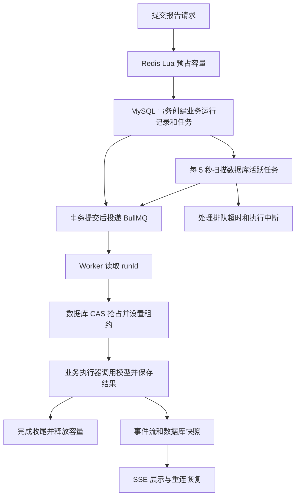
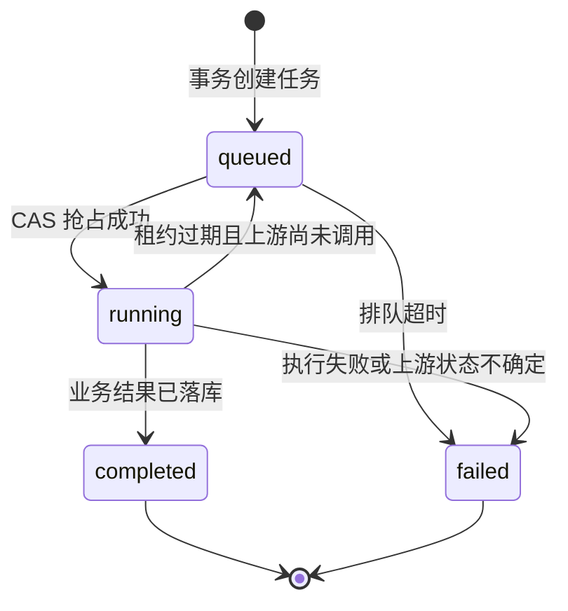

## AI 报告异步任务队列——最强主讲点
业务问题：AI 报告生成耗时长、成本高，请求突增会压垮模型服务；服务重启、网络中断还可能导致任务丢失或重复计费。

AI 报告持久化 MQ 队列：最值得主讲
不是简单 BullMQ 投递。它用 Redis Lua 先做全局排队容量预占，同时在 MySQL 事务中锁住 guard 行、检查活跃任务数，Redis 丢数据后仍以数据库为准：server/src/ai-report-tasks/ai-report-tasks.service.ts:174。

已提交的任务表充当 outbox；Redis 投递失败不会丢任务，由每 5 秒 reconciliation 扫描、补投和恢复：
server/src/ai-report-tasks/ai-report-tasks.service.ts:220。

执行还包含并发上限、lease、CAS 状态抢占、超时取消、任务进度 checkpoint、SSE 断线续传；上游是否已开始无法确认时故意不自动重试，避免 AI 重复计费：
server/src/ai-report-tasks/ai-report-tasks.service.ts:395。

话术：“我把高成本、长耗时的 AI 调用做成可恢复的持久化任务系统，重点解决投递丢失、Worker 宕机、重复执行和重复扣费。”

已有实现：

- BullMQ + Redis 执行异步任务，设置全局并发上限。
- Redis Lua 原子预占队列容量，数据库 guard 行锁兜底容量约束。
- 业务运行记录与任务在事务中落库，提交后的任务记录承担 outbox 职责。
- 定时 reconciliation 补投任务、检查排队超时和执行租约。
- CAS 更新抢占任务，减少多个 Worker 重复执行。
- 区分“上游尚未调用”和“上游调用状态不确定”，后者停止自动重试，避免重复计费。

代码：server/src/ai-report-tasks/ai-report-tasks.service.ts:135

面试重点：数据库与 Redis 双写如何处理？Worker 宕机怎么恢复？为什么不能直接宣称 exactly-once？

可用话术：
我设计了 AI 报告持久化任务队列，通过事务任务表、补偿扫描、执行租约和状态抢占处理投递失败与进程中断，并针对模型调用的不确定状态制定重试边界。

## 任务队列如何实现：AI 报告源码详解

本节以 `server/src/ai-report-tasks/ai-report-tasks.service.ts` 为主线，结合提交调用方、Prisma 模型和额度服务解释实际实现。下面的源码片段只摘录关键部分，省略处用注释标识；示意代码会明确注明。

### 1. 为什么不直接在 HTTP 请求里生成报告？

AI 报告生成耗时长，可能持续几十秒甚至数分钟。直接同步执行会把请求连接、模型调用和业务生命周期绑在一起：请求突增时模型并发失控；页面关闭后用户不知道结果；进程退出后仅存在内存中的任务无法恢复；网络超时后直接重试又可能重复调用、重复计费。

这里的核心不是“把函数放到后台”，而是先把执行意图持久化，再让 Worker 按受控并发执行，并为中断后的恢复提供判断依据。

| 组件 | 实际职责 |
| --- | --- |
| MySQL 的 `AiReportTask` | 保存输入、状态、截止时间、租约和进度快照，是补偿恢复的依据 |
| MySQL 的 `AiToolRun` | 保存业务运行状态和结果；任务完成前要核实业务结果已保存 |
| Redis/BullMQ | 保存调度信息、投递任务、控制执行并发 |
| Worker | 根据任务类型调用注册的业务执行器 |
| `reconcile()` | 周期检查数据库，补投、恢复或终止任务 |
| Redis Stream + SSE | 保存短期事件并向前端展示进度；不是业务结果的唯一来源 |



### 2. 先理解任务模型：队列里放什么，数据库里放什么？

模型在 `server/prisma/schema.prisma` 的 `AiReportTask`。BullMQ 的消息只携带 `{ runId }`，完整输入从数据库任务中读取，避免把 Redis 当作唯一业务存储。

| 字段 | 用途 |
| --- | --- |
| `runId` | 任务主键，关联 `AiToolRun`，同时作为 BullMQ `jobId` |
| `kind` | 区分 stock、portfolio、position、group_backtest，选择执行器与队列范围 |
| `userId` | 校验任务归属，防止其他用户读取结果 |
| `activeKey` | 可空唯一字段，限制同一业务目标的活跃任务；结束后清空 |
| `state` | `queued`、`running`、`completed`、`failed` |
| `payload` | 保存执行输入、上下文和容量预占 token |
| `deadlineAt` | 排队截止时间，创建时设置为当前时间加 10 分钟 |
| `leaseUntil` | 执行或恢复操作的业务租约到期时间 |
| `providerStartedAt` | 上游调用前写入，表示上游可能已经开始处理 |
| `attempt` | 上游调用尝试次数，不是 BullMQ 的重投次数 |
| `snapshot` | 累积正文、阶段事件和 Redis Stream 游标 |
| `updatedAt` | Prisma 自动维护的更新时间，用作 CAS 版本条件 |
| `finishedAt` | 任务进入终态的时间 |



“上游状态不确定”不是独立任务状态，而是以 `failed` 和错误码 `REPORT_EXECUTION_UNCERTAIN` 表达。图中的重新排队主要指普通 AI 报告，回测中断使用更保守的终止策略。

### 3. 入队第一关：Redis Lua 原子预占容量

源码位置：`AiReportTasksService.reserve()`。

```lua
redis.call('ZREMRANGEBYSCORE', KEYS[1], '-inf', ARGV[1])
if redis.call('ZCARD', KEYS[1]) >= tonumber(ARGV[2]) then return 0 end
redis.call('ZADD', KEYS[1], ARGV[3], ARGV[4]); return 1
```

`KEYS[1]` 是容量有序集合，普通 AI 队列使用 `ai:report-tasks:capacity`；参数分别是当前时间、容量上限、预占到期时间、随机 UUID token。

执行顺序是：清除过期 token → 统计当前预占数 → 检查是否已满 → 写入新的预占。Lua 将检查与写入放在一次原子操作中，避免两个请求同时读到“还剩一个位置”后都成功占位。

注意：这个有序集合不是 BullMQ 的任务队列。score 表示容量预占的失效时间，不表示任务优先级。预占期限为排队超时再加 10 分钟，扫描器会为仍活跃的任务刷新它；结束后主动 `ZREM`。

`AI_REPORT_MAX_PENDING = 30` 实际限制的是 `queued + running`，不是“排队 30 个之外还能再运行 5 个”。Redis 不可用、队列未就绪或容量已满时拒绝接单，而不是继续无条件打到模型服务。

### 4. 第二关：数据库行锁兜底，业务记录和任务一起提交

源码位置：`create()`，调用示例在 `server/src/stock-position/portfolio-ai-analysis.service.ts`。

```ts
// create() 中的关键片段
await tx.$queryRaw`SELECT id FROM ai_report_queue_guard WHERE id = 1 FOR UPDATE`;
if (
  (await tx.aiReportTask.count({
    where: { ...this.scope, state: { in: active } },
  })) >= AI_REPORT_MAX_PENDING
) {
  throw new ReportQueueError('REPORT_QUEUE_FULL', '报告队列已满，请稍后重试。');
}
// 随后在同一个 tx 中写入 AiReportTask。
```

为什么 Redis 检查之后还要查数据库？Redis 中的预占可能丢失或过期，仅依赖它会低估真实活跃任务数。数据库行锁让使用同一 guard 的事务串行检查容量，检查和插入处于同一个事务内，数据库成为最终准入约束。

这要求 guard 表中预先存在 `id = 1` 的记录，并且提交路径都遵守该协议；不能把它描述成数据库天然限制任务行数。普通 AI 和回测按 scope 分别计数，但源码使用同一 guard 行，因此准入检查仍会共享这把行锁。

下面是组合报告提交路径的简化示意，省略业务鉴权、日限额和其他锁：

```ts
const reservation = await tasks.reserve();
let submitted = false;
try {
  const runId = await prisma.$transaction(async (tx) => {
    const run = await createRun(/* 业务参数，使用 tx */);
    await tasks.create(tx, {
      runId: run.id, userId, kind: 'portfolio',
      activeKey, payload, reservation,
    });
    return run.id;
  });
  submitted = true;
  await tasks.dispatch(runId);
  await tasks.subscribe(userId, runId, signal, emit);
} finally {
  if (!submitted) await tasks.release(reservation);
}
```

重点是业务运行记录和任务记录一起提交、一起回滚；不能先投 Redis 再提交事务，否则 Worker 可能拿到不存在或尚未提交的业务数据。组合报告调用方在 `finally` 中释放尚未提交的预占；提交后则由任务生命周期管理容量。

`activeKey` 的唯一约束解决同一业务目标重复创建活跃任务的问题，与队列容量限制是两件事。`existing()` 还检查任务用户归属，不能把其他用户的去重目标直接暴露出去。

### 5. 可靠投递：任务表本身承担 outbox 职责

源码位置：`dispatch()`。

```ts
try {
  await this.queue.add(
    'report',
    { runId },
    { jobId: runId, removeOnComplete: true, removeOnFail: true },
  );
} catch {
  this.logger.warn({ event: 'report_dispatch_pending', runId });
}
```

数据库提交成功后，Redis 投递可能失败。这里不回滚已经提交的业务记录，也不把“投递失败”等同于“业务任务不存在”，而是保留 `queued` 任务，由 `reconcile()` 再次投递。

这属于事务 outbox 思路：事务内保存待执行意图，事务外投递，后台补偿。实现中没有独立 outbox 表，也没有 MySQL 与 Redis 的跨系统原子事务。可恢复的依据是已提交的任务行，前提是数据库记录仍在、Redis 和扫描器最终恢复工作。

`jobId = runId` 能避免已有同 ID Job 时重复添加，但不是永久去重。由于完成和失败的 Job 都配置了自动删除，后续仍可能重新投递相同 ID；Worker 必须继续检查数据库状态和执行租约。

### 6. Worker 如何启动？怎么限制全局并发？

源码位置：`onApplicationBootstrap()`。

```ts
await this.queue.setGlobalConcurrency(this.concurrency);
this.worker = new Worker(this.queueName, (job) => this.execute(job.data.runId), {
  connection: this.workerRedis,
  concurrency: this.concurrency,
  lockDuration: 30000,
  maxStalledCount: 1,
});
```

| 配置 | 含义 |
| --- | --- |
| 全局并发 | `setGlobalConcurrency()` 约束同一 BullMQ 队列跨 Worker 的执行并发 |
| 本地并发 | Worker 的 `concurrency` 限制单个 Worker 同时处理的 Job 数 |
| AI 报告队列 | `ai-reports`，当前全局并发上限 5 |
| 回测队列 | `position-group-backtests`，当前全局并发上限 2，容量 token 与扫描范围也隔离 |
| Worker 开关 | 可通过配置关闭某类 Worker，使实例只提交任务或参与其他职责 |

例如部署 3 个 AI Worker，每个本地并发为 5，也不是允许 15 个 Job 同时执行；队列全局上限仍为 5。这个上限控制 BullMQ 调度槽位，不意味着超时后仍在远端执行的请求一定已经停止。

`lockDuration = 30000` 是 BullMQ 的 Job 锁配置，锁由 BullMQ 管理；它不同于数据库 `leaseUntil`。不能把 30 秒理解成 AI 报告只能执行 30 秒。

### 7. 业务执行器如何接入队列？

源码位置：`register()`，以及组合报告服务的 `onModuleInit()`。

```ts
// 队列服务
register(kind: ReportKind, executor: Executor) {
  this.executors.set(kind, executor);
}
```

组合报告服务注册 `portfolio` 执行器，把数据库 `payload` 恢复成业务参数，再调用已有的 `stream()`，并通过 `prepared` 携带已有 `runId` 和准备好的输入。这让通用队列负责生命周期，业务服务负责提示词、模型调用和报告保存。

Worker 的入口只需要 `runId`，随后根据任务的 `kind` 从 `Map` 查找对应执行器。它不是再发一个 HTTP 请求给自己，也不是把业务函数序列化后放进 Redis。

### 8. CAS 抢占：多个 Worker 为什么不会直接一起执行？

源码位置：`execute()`。

执行前先读取任务：不存在、已是终态、属于另一条队列时退出；业务记录已完成则直接补做收尾；已有未到期的执行租约则跳过；有上游调用标记或排队期限已过则进入对应恢复处理。

通过前置检查后，再做条件更新：

```ts
const claimed = await this.prisma.aiReportTask.updateMany({
  where: { runId, state: task.state, updatedAt: task.updatedAt },
  data: { state: 'running', leaseUntil },
});
if (!claimed.count) return;
```

CAS 即“读到的条件仍成立，才允许修改”。假设 A、B 都读到相同任务版本，A 先修改成功，B 的旧 `updatedAt` 不再匹配，更新数量为 0，于是退出。它把读完再写之间的竞争收敛到数据库条件更新，而不是仅靠进程内变量。

这能减少重复执行，但不能单独证明外部调用 exactly-once。租约过期后旧进程可能仍活着，外部服务也不参与数据库事务；源码没有在每一次外部副作用上使用 fencing token 强制拒绝旧执行者。

### 9. 超时、业务租约和结果确认

普通 AI 任务的执行超时为 `AI_CHAT_TIMEOUT_MS`（默认 120 秒）加 60 秒，默认共 180 秒。回测使用单独配置，默认 30 分钟。数据库业务租约设为执行超时再加 30 秒，是固定期限，不是周期心跳续租。

```ts
const controller = new AbortController();
const leaseUntil = new Date(Date.now() + timeoutMs + 30000);
// CAS 成功后启动超时计时器
const timeout = setTimeout(
  () => controller.abort(new Error('REPORT_TIMEOUT')),
  timeoutMs,
);
```

Worker 检查账号可用性，再将 `signal` 和 `emit` 交给执行器。执行器返回后还会读取 `AiToolRun`：只有业务状态已是 `completed` 才将任务完成，否则按失败处理。异常路径也先检查业务是否已经成功落库，避免把已经保存的报告误判为失败。

`AbortSignal` 是协作取消，不是强制终止线程，也不是保证模型供应商停止计费。当前代码的超时回调发出取消信号，但没有用一个强制结束的 Promise 包装任意执行器；执行器不响应信号时可能继续占用执行流程。

排队期限和执行超时也不同：前者决定任务是否还能开始执行；后者约束开始后的执行过程。`provider()` 的重试还会参考排队截止时间，但运行中的任务不会仅因该时间过去就由排队分支直接终止。

### 10. 每 5 秒的补偿扫描到底做什么？

源码位置：`reconcile()` 与 `claimRecovery()`。

启动成功后先扫描一次，再每 5 秒扫描。`reconciling` 防止同一服务实例的扫描重入；它不是跨进程分布式锁，多实例之间仍要依赖数据库 CAS。

扫描活跃任务时先刷新容量 token，再根据状态处理：

| 数据库情况 | 实际处理 |
| --- | --- |
| `queued` 且未超时 | 再次 `dispatch()`，修复提交后投递失败或队列数据丢失 |
| `queued` 且排队超时 | 抢占恢复租约后，标记排队超时失败 |
| `running` 且租约未过期 | 不进入过期恢复分支 |
| 租约过期，但业务结果已完成 | 补做完成收尾，不重新调用模型 |
| 租约过期，上游调用标记存在 | 不确定失败，避免盲目重复计费 |
| 租约过期，普通报告尚无上游调用标记 | 改回 `queued` 并重新投递 |
| 租约过期的回测任务 | 即使没有上游调用标记，也按中断失败处理，不自动重跑 |

恢复前还会抢占一个短期租约：

```ts
const claimed = await this.prisma.aiReportTask.updateMany({
  where: {
    runId: task.runId,
    state: task.state,
    updatedAt: task.updatedAt,
    leaseUntil: task.leaseUntil,
  },
  data: { state: 'running', leaseUntil: new Date(Date.now() + 30000) },
});
return claimed.count === 1;
```

扫描读到任务到真正处理之间，另一个实例可能已经启动或完成任务。`claimRecovery()` 校验状态、版本和旧租约，防止根据过期扫描结果直接覆盖新状态。

Redis 完全丢数据后，不是原有 BullMQ Job 自动恢复，而是数据库活跃任务给出重建依据；仍在有效租约内的任务需要等待执行或后续恢复判断。Redis 长期不可用、数据库不可用或所有扫描器停机时，补偿也无法凭空推进。

### 11. AI 调用为何不采用“失败就重试”？

源码位置：`provider()`。

```ts
await this.prisma.aiReportTask.update({
  where: { runId },
  data: { providerStartedAt: new Date(), attempt: attempt + 1 },
});
try {
  return await call();
} catch (error: any) {
  const rejected =
    error?.code === 'BAILIAN_HTTP_429' &&
    !error?.partial?.text &&
    !error?.partial?.usage?.models?.length;
  // 后续还检查尝试次数和截止时间，再决定是否重试。
}
```

数据库与远程模型接口不在一个事务里。可能发生“供应商已经接单，但响应在网络中丢失”，此时本地超时不等于上游未执行。自动重试会产生第二次请求，可能重复生成和计费。

`providerStartedAt` 在调用前写入，是保守风险标记：存在不代表已经计费，也可能刚写入就宕机、实际请求尚未发出。实现宁可在这种窗口终止自动恢复，也不假定调用安全。

允许重试的条件非常具体：错误是明确 429、没有部分文本、没有模型用量记录、还没有重试过，而且截止时间能容纳等待。最多两次调用，即自动重试一次；等待默认 5 秒，按上游建议调整，并限制在 1～60 秒。符合条件时清空上游调用标记，等待后再次尝试。

超时、流中断、503 等不确定失败不自动重试；429 如果已经有输出或用量也不重试。这是针对当前错误协议的业务策略，不能推广成“所有 429 都一定没计费”。现有测试明确覆盖这些边界。

### 12. 进度如何保存？断线后为什么能继续看？

源码位置：`execute()` 内的 `emit()` 和 `subscribe()`。

执行器发出事件后，`emit()` 做两件事：

1. 更新内存快照：`delta` 累积到正文，其余事件按类型保留最新值；正文超过 300000 字符时报错。
2. 写 Redis Stream，并按时间和事件类型把正文、阶段事件、游标一起保存到数据库。

```ts
const eventId = await this.redis.xadd(
  `ai:report-task:events:${runId}`,
  'MAXLEN', '=', AI_REPORT_EVENTS_LIMIT,
  '*', 'event', JSON.stringify(event),
).catch(() => null);
if (eventId) snapshot.cursor = eventId;
// 普通事件距上次落库至少 1 秒，或 done/error/report 事件时保存快照。
```

事件流最多保留 2000 条。普通进度在事件到来时按约 1 秒节流落库，并非一个后台计时器每秒强制保存；关键事件立即保存，执行结束的 `finally` 也会保存快照。

订阅恢复过程：先校验任务用户归属 → 发送数据库快照并采用其中游标 → `XRANGE` 读取游标之后的事件 → 周期刷新任务状态 → 终态再次读取持久化结果。

虽然 `subscribe()` 接收 `lastId`，初始化时会以数据库快照游标为准，而不是盲目从客户端游标继续追加。前端应把快照当作整体替换依据，避免重复拼接旧 delta。每轮最多读取 200 个事件，循环约每秒刷新一次。

结束后给事件流设置一天 TTL；即使流已过期，仍可依据数据库返回最终结果。但快照落库有间隔，进程骤停可能丢失尚未保存的进度，事件截断也不保证完整事件历史。这里恢复的是展示状态，不是模型生成断点续算。

前端断开会结束 `subscribe()` 循环，不会直接取消 Worker 的独立执行信号。已经提交的任务继续由 Worker 执行，页面重新连接后查任务或订阅即可恢复展示。

### 13. 收尾与退款怎样避免残留占位？

源码位置：`settle()`、`fail()`，以及 `server/src/user/stock-report-quota.service.ts` 的 `refundFailedRuns()`。

`settle()` 更新终态和完成时间，清空 `activeKey`、`leaseUntil`，广播队列变化，释放容量 token，并设置事件 TTL。失败路径会再次检查业务结果是否已成功，然后更新业务失败状态并调用收尾与额度补偿。

这些步骤不是一个涵盖数据库和 Redis 的大事务。若终态已保存、token 删除失败，该 token 不再被活跃任务扫描刷新，后续到期清理可解除残留占位；这期间可能短暂低估可用容量，不是即时强一致释放。

退款服务的核心是条件更新：

```ts
await this.prisma.stockReportQuotaUsage.updateMany({
  where: {
    ...(userId ? { userId } : {}),
    state: 'CHARGED',
    OR: [
      { run: { status: 'failed' } },
      { providerStartedAt: null, run: { status: 'cancelled' } },
    ],
  },
  data: {
    state: 'REFUNDED',
    refundedAt: new Date(),
    reason: 'SYSTEM_FAILURE_OR_NOT_STARTED',
  },
});
```

只有 `CHARGED` 记录会变成 `REFUNDED`，重复扫描不会再对同一条已退款记录执行这次状态转换。扫描器也会调用退款检查，补偿“失败已落库、退款前进程退出”的窗口。

退回的是系统内报告使用额度，不是撤销供应商费用。即使上游可能计费，业务也可以选择给用户恢复额度，两种账不能混为一谈。

### 14. 用具体故障串起整个设计

| 故障点 | 为什么能处理 | 仍需说明的边界 |
| --- | --- | --- |
| 事务提交前退出 | 事务未提交的业务记录与任务一起回滚 | Redis 预占可能残留，依靠释放或到期清理 |
| 提交成功、投递前退出 | 数据库已有 queued 任务，扫描器补投 | 依赖扫描器和 Redis 最终恢复 |
| 同一任务被重复投递 | jobId、终态检查、有效租约、CAS 共同减少重复消费 | 不是永久去重，也不是外部副作用 exactly-once |
| Worker 尚未调用模型就退出 | 租约过期后可恢复普通报告 | 必须没有上游调用风险标记 |
| 模型已接单、Worker 退出 | 标记不确定失败，阻止自动重放 | 可能牺牲自动成功率，需要用户手动决策 |
| 结果已保存、任务还未完成 | 读取业务 completed 状态后补收尾 | 任务状态和结果仍存在短暂同步窗口 |
| 用户关闭页面 | 只停止订阅，Worker 继续执行 | 未提交前的请求取消仍按提交路径处理 |
| Redis 丢失事件或 Job | 任务和结果主要依据数据库恢复 | 不承诺完整恢复每个未落库增量事件 |

### 15. 面试可以怎样讲？

**一分钟版本：**

我把 AI 报告生成做成了 MySQL 持久化任务表加 BullMQ 的异步系统。提交时先用 Redis Lua 预占容量，再在数据库事务里通过 guard 行锁检查活跃任务上限，把业务记录和任务一起落库。提交后再投递 BullMQ，投递失败由每 5 秒扫描任务表补偿。Worker 用全局并发限制模型压力，通过数据库 CAS 和业务租约减少重复执行。进程中断后，如果模型还没开始，可以重新排队；如果上游可能已经接单，就停止自动重试，避免重复计费。进度用 Redis Stream 加数据库快照保存，前端断开不会取消已提交任务，重连后恢复展示。

**展开讲源码的顺序：**

先讲 `reserve()` 与 `create()`，说明容量控制和事务边界；再讲 `dispatch()` 与 `reconcile()`，说明双写窗口如何补偿；然后讲 `execute()`、`claimRecovery()` 和 `provider()`，说明抢占、宕机恢复及重试边界；最后讲 `emit()`、`subscribe()`、`settle()`，说明进度和收尾。

| 面试追问 | 回答重点 |
| --- | --- |
| 为什么不用纯数据库轮询？ | 数据库负责可靠记录，BullMQ 提供现成的调度、Worker、全局并发和 Job 锁；扫描器只做低频兜底，不是唯一调度方式 |
| MySQL 和 Redis 双写如何一致？ | 不假装跨系统原子提交，先持久化执行意图，失败后补投，接受调度状态最终收敛 |
| 有 BullMQ 锁为什么还要 CAS？ | Redis 调度锁不能代替数据库业务状态保护；重投和多实例恢复时仍需确认自己操作的是同一任务版本 |
| 是否做到 exactly-once？ | 没有；重复投递可控不代表远程模型调用恰好一次，数据库与供应商不共享事务 |
| Worker 宕机为什么不一律重试？ | 高成本远程调用可能已被接受，不确定失败重试会重复计费；先检查持久化结果和调用标记 |
| 容量、并发、限流有什么区别？ | 容量约束活跃积压量，并发约束同时调度执行量，限流约束单位时间接收或调用频率，三者不能互相替代 |
| 能断点续算吗？ | 当前是进度快照恢复与有限重试，不是让模型从某个 token 继续执行 |

### 16. 不夸大实现：能力边界与可演进方向

目前有持久化任务、周期补偿、受控执行和保守重试，但不能描述成“绝不丢任务、绝不重复执行、任意故障自动恢复”。可靠性依赖数据库、Redis、执行器对取消信号的响应以及扫描器的持续运行。

固定业务租约不会持续证明旧执行者已停止；CAS 保护的是特定状态转换，不是每一次远端副作用。若要进一步增强，可评估上游幂等请求键、结果查询与对账、执行所有权 token、长任务续租及更完整的告警。这些属于后续设计方向，不是当前服务已经实现的保证。

### 17. 源码阅读与已有测试核对

| 阅读入口 | 关注内容 |
| --- | --- |
| `server/src/ai-report-tasks/ai-report-tasks.service.ts` | `reserve/create/dispatch/execute/provider/reconcile/claimRecovery/subscribe/settle/fail` |
| `server/src/stock-position/portfolio-ai-analysis.service.ts` | 执行器注册、事务提交顺序、未提交预占释放 |
| `server/prisma/schema.prisma` | `AiReportTask`、`AiReportQueueGuard`、唯一约束与索引 |
| `server/src/common/constant.ts` | 容量、并发、排队超时、事件数量及 TTL |
| `server/src/user/stock-report-quota.service.ts` | 条件退款和周期补偿 |
| `server/src/ai-report-tasks/ai-report-tasks.service.spec.ts` | 容量满或 Redis 不可用时拒绝接单、数据库 guard、投递失败、重复消费、结果恢复、不确定调用、429 重试、订阅断开 |
| `server/src/ai-report-tasks/ai-report-tasks.integration.spec.ts` | 两个 Worker 下的队列全局并发上限场景 |

以上测试用于核对设计意图，不等于已经证明所有分布式故障时序都安全；本次是文档整理，没有修改任务实现。
