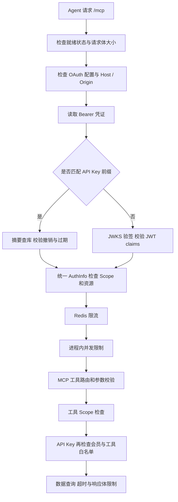

# MCP 实现：双鉴权、工具授权与权限控制

## 1. 业务问题与设计目标

向外部 Agent 开放内部金融数据，不能只解决“工具能调用”。还需要明确谁在调用、凭证能访问什么、用户降级或撤销 Key 后如何生效，以及多个客户端如何共享流量配额。

本项目使用 NestJS 承接 HTTP，MCP SDK 提供协议与工具注册，通过 OAuth Access Token 和会员 API Key 两条路径认证，统一进入工具授权和资源保护链路。

本文依据 `server/src/mcp` 的实际源码。代码块为关键源码摘录或明确标注的流程示意，省略部分不代表完整可运行文件。默认 Scope 用 `market:read` 举例，实际以 `MCP_REQUIRED_SCOPE` 配置为准。

| 组件 | 职责 |
| --- | --- |
| Agent / MCP 客户端 | 发现工具、携带凭证、发起调用并解读结果 |
| 授权服务器 | 承担 OAuth 登录、用户授权和令牌签发 |
| MCP 资源服务器 | 验证令牌、检查权限、控制流量、执行只读工具 |
| MySQL | 保存 API Key 摘要、撤销时间、有效期和用户状态 |
| Redis | 在多个服务实例间共享限流计数 |
| 数据服务 | 读取已有行情、技术分析、财务和盘口数据 |

双鉴权表示“两种可选认证方式”，不是一次请求同时提交 OAuth Token 和 API Key，也不是双因素认证。两者都通过 `Authorization: Bearer ...` 传输。

## 2. 从 HTTP 请求到工具执行



入口为 `McpController.handleMcp()`，调用 `McpServerService.handle()`。控制器上的 `@Public()` 表示绕过应用原有登录守卫；它不表示 MCP 匿名开放。独立的 Bearer 鉴权由 `McpServerService.onModuleInit()` 创建。

关键源码摘录：

```ts
const authGate = sdk.requireBearerAuth({
  verifier: {
    verifyAccessToken: async (token: string) => {
      // 实际代码还将 McpAccessTokenError 映射为 SDK InvalidToken。
      return this.auth.verifyAccessToken(token);
    },
  },
  requiredScopes: [requiredScope],
  resourceMetadataUrl,
  expectedResource: oauthConfiguration.audience,
});
```

SDK 负责 Bearer 接入、Scope 和预期资源检查；业务 verifier 负责验证凭证并构造可信身份。配置不完整时不会跳过鉴权，而是返回 `503 MCP_OAUTH_NOT_CONFIGURED`。API Key 路径也依赖这套配置，并不是独立于 OAuth 配置即可运行的备用入口。

## 3. 双鉴权如何统一为 AuthInfo

`McpAuthService.verifyAccessToken()` 根据前缀分流：

```ts
async verifyAccessToken(token: string): Promise<AuthInfo> {
  if (token.startsWith(this.apiKeys.getPrefix())) {
    return this.apiKeys.verifyAccessToken(token);
  }
  return this.oauth.verifyAccessToken(token);
}
```

默认 API Key 前缀为 `lj_`，可通过 `MCP_API_KEY_PREFIX` 修改。前缀仅决定使用哪种验证器，本身不证明凭证合法；命中前缀但校验失败时，不会再降级尝试 OAuth。

| 字段 | OAuth 路径 | API Key 路径 |
| --- | --- | --- |
| `clientId` | 优先取 `client_id`，再取 `azp`、`sub` | `liangjian-api-key:` 加 Key ID |
| `scopes` | 从已验签 payload 的 `scope`、`scp` 提取 | 服务端赋予配置中的 requiredScope |
| `expiresAt` | JWT 的 `exp` | 数据库有效期转换成秒 |
| `resource` | 配置中的 audience | 同一 audience |
| `extra` | issuer、身份摘要 | userId、credentialId、authType、Key 限额、身份摘要 |

这里的 Scope 不是从客户端任意请求参数读取。OAuth Scope 来自签名保护的 claims；API Key Scope 来自服务端策略。会员是否仍有效，需要在工具执行前继续检查。

## 4. OAuth：远端 JWKS 与 JWT 信任校验

### 4.1 为什么需要 JWKS？

授权服务器持有私钥签发 JWT，MCP 服务通过配置的 JWKS 地址取得公钥验签，不需要保存签发私钥。JWT 头部的 `kid` 可用于选择对应公钥，远端 JWKS 机制支持配合授权服务器的密钥轮换。

`McpOAuthService` 重用远端 JWK Set 对象；JWKS 地址变化时重新创建。关键源码：

```ts
this.remoteJwks = jose.createRemoteJWKSet(config.jwksUri, {
  timeoutDuration: 3_000,
  cooldownDuration: 30_000,
});

const verified = await jose.jwtVerify(token, this.remoteJwks, {
  issuer: config.issuer.toString(),
  audience: config.audience.toString(),
  algorithms: ['RS256'],
  clockTolerance: 5,
});

const payload = verified.payload;
if (!Number.isInteger(payload.exp)) {
  throw new McpAccessTokenError('Token exp claim is required.');
}
```

`cooldownDuration` 是远端重新获取密钥的冷却参数，不能解释成“Token 30 秒过期”或“每个请求都重新下载公钥”。已有可用缓存时，JWKS 端暂时不可达也不必然使所有验签失败；需要获取密钥且获取失败时，不能放行未验证的 Token。

### 4.2 为什么验签后还要检查 audience 和 Scope？

| 检查 | 回答的问题 | 不检查的后果 |
| --- | --- | --- |
| RS256 签名 | 内容是否由可信密钥签发、是否被修改 | 接受伪造身份或篡改权限 |
| issuer | 是否来自本系统认可的签发方 | 混用其他租户或发行方的凭证 |
| audience | 令牌是否签给本资源服务 | 把签给其他 API 的合法 Token 拿来调用 MCP |
| exp | 是否已过有效期；本实现要求存在整数 exp | 接受过期或缺少明确期限的令牌 |
| nbf | 如果声明了，当前是否已到可使用时间 | 提前使用尚未生效的令牌 |
| Scope | 是否允许执行这里要求的能力 | 合法登录身份越权读取金融数据 |

签名正确只说明“这份声明可信”，不等于“这份声明允许访问当前接口”。`jwtVerify()` 验证时间等信任约束，后续 SDK 和工具执行链路再要求配置中的 Scope。

Scope 提取合并空格分隔的 `scope`、数组或字符串形式的 `scp`，并去重；不会把 Auth0 的 `permissions` 自动当成 OAuth Scope。已有测试明确覆盖这一点。

配置中的资源地址、issuer、audience、JWKS 地址都要求 HTTPS；只有测试环境的 localhost 或 127.0.0.1 允许 HTTP。

## 5. OAuth 元数据与 PKCE S256 的职责边界

### 5.1 资源服务器如何被发现？

控制器提供以下资源元数据入口：

```text
/.well-known/oauth-protected-resource
/.well-known/oauth-protected-resource/mcp
```

返回 `resource`、`authorization_servers`、`scopes_supported` 和 `bearer_methods_supported: ['header']`。SDK 配置中的 `resourceMetadataUrl` 指向根路径的规范入口，让客户端能够发现应向哪个授权服务器申请哪种权限。

元数据正常响应允许缓存 300 秒；配置缺失返回 503，并设置 `Cache-Control: no-store`。这些端点用于发现，不承接用户登录、授权码交换或令牌签发。

### 5.2 PKCE 解决什么问题？

PKCE 用于授权码流程，降低授权码被截获后遭冒用的风险。客户端生成随机 `code_verifier`，授权时提交由其计算的 `code_challenge`，换取 Token 时再提交 verifier，由授权服务器验证二者是否匹配。

```text
S256 challenge = BASE64URL(SHA256(code_verifier))
```

它保护的是“授权码交换”，不能替代 MCP 收到 Access Token 后的签名、audience 和 Scope 校验。

`assertAuthorizationServerSupportsPkce()` 获取 issuer 对应的 OpenID discovery 文档，并要求：

```ts
if (
  !Array.isArray(metadata.code_challenge_methods_supported) ||
  !metadata.code_challenge_methods_supported.includes('S256')
) {
  throw new Error('Authorization server does not advertise PKCE S256.');
}
```

实际边界：源码实现了这项能力检查，测试也调用了它，但当前生产源码中未发现调用点。因此不能表述为“启动时已经强制检查 PKCE”。即使发现文档声明支持 S256，也不等于资源服务器亲自验证了每一次授权码交换；流程执行和约束由授权服务器及客户端承担。

## 6. API Key：生成、存储与并发创建控制

### 6.1 为什么只保存 SHA-256 hash？

创建时生成 32 字节随机数，编码为 base64url 后拼接前缀：

```ts
const apiKey = `${this.getPrefix()}${randomBytes(32).toString('base64url')}`;
const keyHash = this.hash(apiKey);
// hash() 使用 createHash('sha256').update(value).digest('hex')。
```

数据库的 `McpApiKey` 保存 `keyHash`、`keyHint`、所属用户、名称、有效期、撤销时间及每分钟限额，`keyHash` 有唯一索引。完整 Key 仅在创建返回值 `{ apiKey, key }` 中提供，列表不会再次返回。

这样数据库泄露后，攻击者不能直接把摘要当作 Bearer Key 使用。这里是高熵随机凭证，不是用户自选的低熵密码；不能据此推导“用户密码也直接用 SHA-256 存储”。随机源、HTTPS、日志脱敏仍然重要，摘要存储无法保护客户端已经泄露的原始 Key。

默认有效 Key 上限为 5，默认单 Key 限额为每分钟 60 次。有效期只允许 7、30、90、365 天；默认 90 天，可通过 `MCP_API_KEY_DEFAULT_EXPIRY_DAYS` 配置，配置不在允许范围时回退到 90 天。名称要求 1～64 字符。

### 6.2 为什么创建时锁用户行？

如果仅先 count 再 insert，用户已有 4 个 Key 时，两个并发请求都可能读到 4，随后各插入一个，突破 5 个上限。

`createKey()` 在同一事务中锁定用户行，再查询会员和有效 Key 数量，最后插入。关键源码摘录：

```ts
const created = await this.prisma.$transaction(async (tx) => {
  const locked = await tx.$queryRaw<Array<{ id: string }>>(Prisma.sql`
    SELECT id FROM \`user\` WHERE id = ${userId} FOR UPDATE
  `);
  // 省略：确认用户存在、未删除、属于允许的会员方案。
  const activeCount = await tx.mcpApiKey.count({
    where: { userId, revokedAt: null, expiresAt: { gt: now } },
  });
  if (activeCount >= maxActiveKeys) {
    // 实际代码抛出 API_KEY_LIMIT_REACHED，HTTP 409。
    throw new McpApiKeyError(
      'API_KEY_LIMIT_REACHED',
      `At most ${maxActiveKeys} active API keys are allowed.`,
      409,
    );
  }
  return tx.mcpApiKey.create({
    // 省略：写入摘要、所属用户、有效期等字段与返回字段选择。
  });
});
```

锁让遵循相同创建协议的同一用户请求串行检查数量；事务保证检查和插入一起提交或回滚。不同用户有不同的锁定行。上面 `create` 参数为省略示意，不是完整 Prisma 调用。

## 7. API Key 校验、撤销与会员降级

### 7.1 每次请求如何验证？

`McpApiKeyService.verifyAccessToken()` 计算 Bearer Key 的摘要，按唯一 `keyHash` 查询数据库，并关联用户的删除状态：

```ts
const row = await this.prisma.mcpApiKey.findUnique({
  where: { keyHash },
  include: { user: { select: { id: true, deletedAt: true } } },
});
const now = new Date();
if (
  !row ||
  row.revokedAt ||
  row.expiresAt.getTime() <= now.getTime() ||
  row.user.deletedAt
) {
  throw new McpAccessTokenError('Invalid or expired API key.');
}
```

通过后构造可信 `AuthInfo`。此处检查凭证和用户删除状态；会员方案检查发生在工具执行前的 `assertApiKeyToolAccess()`，不要混写成全部都在 verifier 中完成。

### 7.2 撤销是不是立即生效？

`revokeKey(userId, keyId)` 先按 Key ID 和当前用户 ID 查询，防止操作别人的 Key，再更新 `revokedAt`。重复撤销返回现有结果。

后续请求重新查库时会发现撤销，因此没有应用层认证缓存带来的额外等待窗口。但一个已经完成鉴权、正在执行的请求不会因更新 `revokedAt` 自动停止；“后续请求失效”和“强制终止所有在途任务”是不同能力。

工具执行前会重新查询用户的 `planType`，要求 `Basic`、`Advanced`、`God` 中的一种。用户降级后，后续工具权限检查会拒绝访问，即使 Key 还未过期。权限读取之后的并发降级也不是事务式的全程撤销保证。

### 7.3 管理 Key 的接口与 MCP 入口分开

| 接口 | 用途 |
| --- | --- |
| `GET /api/mcp/access` | 查询会员资格、有效 Key 数量和创建策略 |
| `GET /api/mcp/api-keys` | 返回当前用户 Key 的公开信息与状态 |
| `POST /api/mcp/api-keys` | 创建 Key，一次返回完整凭证 |
| `DELETE /api/mcp/api-keys/:id` | 撤销当前用户的 Key |

这些管理接口从登录态 `req.user.id` 取得用户身份；没有使用 MCP 入口的 `@Public()`。不能允许调用者在请求体随意指定所属用户。列表状态包括 ACTIVE、EXPIRING_SOON、EXPIRED、REVOKED，临近过期阈值为 7 天。

## 8. 工具注册与授权：有身份不等于能执行

### 8.1 工具声明与执行保护

`buildServer()` 注册工具，统一设置只读等提示、Scope challenge 和 OAuth 安全元数据：

```ts
const common = {
  annotations: {
    readOnlyHint: true,
    destructiveHint: false,
    idempotentHint: true,
    openWorldHint: false,
  },
  scopeChallenge: sdk.requireScopes(requiredScope),
  _meta: {
    securitySchemes: [{ type: 'oauth2' as const, scopes: [requiredScope] }],
  },
};
```

这些 annotations 是给客户端的行为提示，不能替代后端鉴权，也不构成数据库只读权限的强制保证。

以 `getStockKline` 为例，输入 Zod schema 使用 `.strict()`，要求 symbol 长度 1～16，日线 interval 为 `1d`，limit 为 1～500、默认 260，复权方式只接受 RAW 或 QFQ。限制参数规模，可以避免 Agent 传入无界查询。

工具回调统一交给 `executeTool()`，其中优先使用 handler 传入的身份，否则使用创建 server 时的身份：

```ts
const auth = handlerAuth ?? factoryAuth;
if (!auth?.scopes.includes(requiredScope)) {
  return this.errorResult(
    'INVALID_ARGUMENT',
    `${requiredScope} scope is required.`,
  );
}
await this.auth.assertApiKeyToolAccess(auth, toolName, requiredScope);
// 权限通过后才调用实际数据服务。
```

HTTP 入口检查与工具执行检查各自覆盖不同层级。工具侧即使发现权限不足，也不会先执行查询再丢弃结果。

### 8.2 当前开放哪些工具？

| 工具 | 主要用途 |
| --- | --- |
| `getStockKline` | A 股历史日 K，区分正式与盘中临时数据 |
| `getStockQuote` | 行情快照，带延迟与时间信息 |
| `getStockKlineAnalyzer` | 已有技术状态的结构化结果 |
| `getStockKlineAnalyzerContext` | 技术状态与配套中文报告上下文 |
| `getStockFinancial` | 按报告期组织的财务快照与允许的后端派生结果 |
| `getCryptoKlineContext` | 加密货币多周期 K 线上下文 |
| `getPolymarketOrderBook` | 当前 YES/NO 盘口信息 |

API Key 路径需要满足 Scope、用户存在且未删除、会员方案有效、工具名属于 `ALLOWED_TOOLS`。当前三个允许的会员方案共享这份白名单，不能说成已经实现不同会员等级对应不同工具权限。

OAuth 路径不会执行本地会员检查，也不要求映射为本地用户，其权限依赖已信任的 OAuth 声明、requiredScope 和当前实际注册的工具。不能把 API Key 的会员规则描述为两条路径共有的规则。

## 9. 用户级与 Key 级 Redis 原子限流

### 9.1 为什么不能只按 Key 限流？

假设每个 Key 每分钟可以请求 60 次，只限制 Key 时，一个用户创建 5 个 Key 就可能获取 300 次额度。项目同时限制用户总量和单 Key 流量：

```text
Key A ─┐
Key B ─┼─ 用户共享桶：默认 60 次 / 60 秒
Key C ─┘
每个 Key 另有自己的桶：默认 60 次 / 60 秒
```

API Key 桶名称分别为 `mcp:rate:user:` 加 userId 摘要和 `mcp:rate:key:` 加 credentialId 摘要。Key 限额优先读取该 Key 数据库记录映射到身份中的值；因此修改默认配置不等于自动更新所有已创建 Key 的持久化限额。

OAuth 路径使用 `mcp:rate:` 加 `subjectKey(auth)`。一般来自已验证 `sub` 的摘要，没有 sub 时回退到 client identity。OAuth 与 API Key 目前并不是统一映射到同一个本地用户桶，不能宣称跨两种凭证也已共享总额度。

### 9.2 Lua 如何保证单桶计数原子性？

`RedisService.consumeFixedWindow()` 执行：

```lua
local count = redis.call('INCR', KEYS[1])
if count == 1 then redis.call('EXPIRE', KEYS[1], ARGV[1]) end
local ttl = redis.call('TTL', KEYS[1])
return {count, ttl}
```

应用根据 `count <= limit` 判断是否允许，TTL 用于计算重试等待时间。首个请求创建计数并设置 60 秒过期；后续请求只自增，不不断刷新 TTL。这是从该桶首次计数开始的固定窗口，不是自然分钟对齐，也不是滑动窗口。

若拆成独立 INCR、EXPIRE，进程可能在自增后崩溃，导致计数没有过期时间。Lua 将这组操作在 Redis 内原子执行，避免这类中间状态。

### 9.3 双桶不是一个跨桶事务

API Key 路径使用 `Promise.all()` 并行消费两个桶，然后要求结果全部允许。每个桶内部原子，但两个桶合起来不是一次全有或全无事务。

如果用户桶已经超限，Key 桶仍可能被计数；即使请求被拒，计数也不会回滚。限流发生在工具执行之前，因此计数单位是通过认证后的 MCP HTTP 请求，不是成功的数据查询次数，更不是“成功报告数量”。

超限返回 429，并以拒绝结果中较大的等待时间设置 `Retry-After`。固定窗口边界前后可能短时集中通过接近两倍窗口额度；若业务需要更平滑的速率，可另行采用滑动窗口或令牌桶。

### 9.4 Redis 故障为什么返回 503？

限流异常时返回 `503 Rate limiter is unavailable`，不会因为 Redis 不可用而无条件放行。这是 fail-closed：对于对外数据入口，宁可暂时不可用，也不失去流量控制。

代价是 Redis 进入可用性关键路径。生产上应监控错误率、延迟、容量和故障恢复；未来即使设计降级，也要有明确受限策略，不能把当前实现描述成已有自动备用限流器。

## 10. Host / Origin、并发与资源边界

### 10.1 Host 与 Origin 检查

Host 白名单来自 `MCP_ALLOWED_HOSTS`，并加入资源 URL 的 hostname；非生产环境额外允许 localhost 和 127.0.0.1。校验委托给 SDK，可用于收紧可接受的目标主机并降低 DNS rebinding 等入口风险。

Origin 只在请求携带该头时检查。配置中的 URL 会被转换成 hostname 后传给 SDK，因此不能描述成严格比较协议、域名和端口组成的完整 Origin。

非浏览器 Agent 通常可以不带 Origin；Host/Origin 检查既不能识别用户，也不能代替 Bearer 凭证。对反向代理部署，还需要核实代理实际传入的 Host 与白名单是否一致。

### 10.2 限制默认值与作用范围

| 配置 | 默认值 | 实际作用 |
| --- | --- | --- |
| `MCP_REQUEST_LIMIT_BYTES` | 65,536 字节 | 检查声明大小、已解析 JSON 大小，SDK handler 也配置请求大小上限 |
| `MCP_RESPONSE_LIMIT_BYTES` | 524,288 字节 | 检查工具输出 JSON 的 UTF-8 字节数，不是完整 HTTP 传输体大小 |
| `MCP_TOOL_TIMEOUT_MS` | 5,000 毫秒 | 包装数据查询 Promise 的等待时长 |
| `MCP_MAX_CONCURRENCY` | 20 | 当前服务实例内的 MCP HTTP handler 在途数量 |
| `MCP_RATE_LIMIT_PER_MINUTE` | 60 | OAuth 身份桶 |
| `MCP_USER_RATE_LIMIT_PER_MINUTE` | 60 | API Key 用户共享桶 |
| `MCP_API_KEY_RATE_LIMIT_PER_MINUTE` | 60 | 新 Key 默认限额及相关回退值 |

`inFlight` 在 handler 前递增，在 `finally` 中递减。它是实例内存计数，多实例部署时不能直接当作全局并发上限；并且它跟踪 handler 生命周期，不保证覆盖脱离 handler 后仍在运行的底层操作。

`withTimeout()` 使用 `Promise.race()` 返回超时错误并清理定时器，没有传递 AbortSignal 取消底层任务。因此“客户端收到超时”不等于“数据库或远端请求已经停止”。还应区分工具数据查询超时与查询前的会员数据库检查，后者不在这一段 timeout 包装内。

## 11. 工具结果、错误与审计

成功时同时返回文本 JSON 与结构化内容：

```ts
return {
  content: [{ type: 'text' as const, text }],
  structuredContent: output as Record<string, unknown>,
};
```

工具执行失败返回 `isError: true`，文本内容包含 error code、message 和 retryable。已知授权错误和业务错误映射为工具错误；未知异常向客户端返回通用消息，避免直接暴露内部异常细节。

需要区分三个层面：HTTP 请求是否接受、MCP 协议调用是否完成、工具业务结果是否成功。工具级 `isError` 不等于一定返回 HTTP 403 或 500。当前工具 Scope 兜底检查使用 `INVALID_ARGUMENT`，文档不能擅自改写成该分支实际返回 403。

日志记录工具名、身份摘要、状态与耗时，便于排查，不在这些工具日志中直接输出完整 Bearer Token。身份摘要只是降低直接暴露身份的风险，不应宣称完全匿名或不存在关联性。

## 12. 故障场景与实际保证

| 场景 | 当前行为或边界 |
| --- | --- |
| OAuth 配置缺失 | `/mcp` 返回 503，API Key 也不会绕过配置要求 |
| JWT 签名错误、issuer 或 audience 不匹配 | verifier 拒绝，映射为无效 Token |
| JWT 过期或缺少整数 exp | 拒绝；有 5 秒时钟容差 |
| Scope 不足 | 入口 SDK 拒绝；工具层还有检查与 challenge |
| Key 撤销、过期或用户删除 | 后续验证请求查库后拒绝 |
| API Key 用户会员降级 | 后续工具权限检查拒绝，不保证终止在途调用 |
| 用户切换多个 API Key | 同一用户桶仍累计，不能仅靠切 Key 扩大额度 |
| Redis 限流异常 | 返回 503，拒绝继续执行 |
| 请求频率或实例并发超限 | 返回 429，提供 Retry-After |
| 工具查询超时 | 返回可重试的 UPSTREAM_TIMEOUT；底层操作不保证取消 |
| 授权服务器撤销某个 JWT | 当前无本地逐令牌黑名单或 introspection，不能承诺立即失效 |
| 增加新工具 | 需同时检查注册、Scope、API Key 白名单、输入输出及数据规模 |

JWT 离线验签的优势是减少逐请求远端依赖，代价是本地不知道授权服务器刚发生的逐令牌撤销。短期 Access Token、撤销列表、introspection 或策略版本检查是可能的后续方案，不是当前已实现能力。JWKS 密钥轮换也不应直接当作单个用户 Token 的精确撤销机制。

## 13. 面试一分钟话术

“我为外部 Agent 访问内部金融数据实现了 MCP 入口，支持 OAuth Access Token 和会员 API Key 两种 Bearer 凭证，统一转换为可信身份。OAuth 路径通过远端 JWKS 验证 RS256，并校验 issuer、audience、有效期及 Scope；API Key 用高熵随机数生成，数据库只保存 SHA-256 摘要，支持有效期、撤销和所属用户校验。

工具执行前会检查 Scope，API Key 还会实时查询会员状态和工具白名单。流量侧使用 Redis Lua 做单桶原子计数，同时限制用户总量和单 Key 流量，避免创建多个 Key 扩大额度；限流服务不可用时返回 503。此外还有 Host/Origin、请求大小、进程并发和工具查询超时保护。我会明确区分已有保障与边界，例如 Key 撤销针对后续请求，JWT 离线验签不提供即时逐令牌撤销。”

如果提到 PKCE，可以补充：“资源服务提供 OAuth 元数据，也实现了 S256 支持检查方法；登录授权与授权码交换由授权服务器承担，目前还需要将该检查接入实际初始化或部署验证流程。”

## 14. 面试追问与回答要点

### 认证与授权有什么区别？

认证确认凭证代表谁、是否可信；授权决定该身份能执行什么。JWT 验签或 Key 查库属于认证，Scope、会员方案和工具白名单属于授权。凭证有效但会员降级，仍可以被拒绝执行工具。

### 为什么签名验证成功还要检查 audience？

同一签发方可能为多个 API 发 Token。签名正确但 audience 不属于当前资源，就是“凭证是真的，但不是发给这里的”。Scope 再进一步限制可以执行的能力。

### API Key 为什么不存明文，也不需要解密？

服务只需验证提交值是否匹配，不需要恢复原文；将高熵 Key 做摘要后比较即可。完整 Key 丢失就创建新 Key 并撤销旧 Key，不能从数据库找回。

### 多个 Key 如何防止绕过限流？

同时限制 userId 和 credentialId。用户桶控制账号总量，Key 桶控制单个集成的流量，两个都允许才放行。补充说明：当前双桶分别原子，并非整体事务；不同账号、OAuth 与 API Key 跨路径总量不是这套共享用户桶已经解决的问题。

### 为什么用 Lua，不直接 INCR 然后 EXPIRE？

为了避免进程在两条命令之间失败留下没有 TTL 的计数器。Lua 将自增、首次设置 TTL 和读取 TTL 在 Redis 内一次完成；这不意味着业务查询也进入了同一个事务。

### Key 撤销和 JWT 撤销有什么区别？

Key 每次查本地数据库，可在后续请求发现 revokedAt；JWT 当前只离线验证签名和 claims，没有逐 Token 远端查询，因此有效期内的撤销感知需要额外设计。二者都不能自然推导出已经执行的调用会被中止。

### PKCE 和 JWT 验签分别防什么？

PKCE 绑定授权码与发起流程的客户端，防范授权码被截获后冒用；JWT 验签和 claims 检查保护资源接口的 Token 使用。它们处在不同阶段，不能互相替代。

### 为什么 Redis 挂了不直接放行？

对外金融数据入口失去流量控制会把风险传给数据库和下游，因此选择 fail-closed。代价是依赖 Redis 可用性，需要高可用部署和监控；这是安全、成本与可用性的明确取舍。

### 新增工具为什么要检查白名单？

当前 API Key 的服务端授权还有工具名白名单，只注册工具可能让 OAuth 路径可调用、API Key 路径仍拒绝。应同时评估 Scope 颗粒度、会员规则、查询规模与输出数据，不能把“只读工具”理解为没有敏感数据风险。

### 你认为还可以改进什么？

可根据业务需求接入 PKCE 能力检查、收紧完整 Origin 策略、增加 OAuth 撤销感知、实现全局并发控制和底层查询取消；若有分级会员或敏感工具，可细化 Scope 和授权矩阵。这些是演进方向，不包装成当前已经完成的功能。

## 15. 源码与已有测试阅读顺序

以下路径相对于 `data-analysis/server`，方法名用于定位，避免依赖易变的行号：

| 源码 | 重点阅读 |
| --- | --- |
| `src/mcp/mcp.controller.ts` | `/mcp` 入口、资源元数据接口 |
| `src/mcp/mcp-server.service.ts` | `onModuleInit`、`handle`、`buildServer`、`executeTool`、`rateLimit`、`validateOriginAndHost` |
| `src/mcp/mcp-auth.service.ts` | 验证器分流、`assertApiKeyToolAccess` |
| `src/mcp/mcp-oauth.service.ts` | 配置与 HTTPS 校验、远端 JWKS、JWT claims、PKCE 支持检查 |
| `src/mcp/mcp-api-key.service.ts` | `createKey`、`verifyAccessToken`、`revokeKey`、状态展示 |
| `src/mcp/mcp-access.controller.ts` | 登录用户管理自己的 Key |
| `src/common/redis.service.ts` | `consumeFixedWindow` Lua 脚本 |
| `prisma/schema.prisma` | `McpApiKey` 字段、唯一索引和用户关联 |

已有测试可作为行为证据：OAuth 测试覆盖签名、issuer、audience、过期、nbf、缺失 exp、permissions 不充当 Scope，以及 PKCE 元数据能力检查；API Key 测试覆盖摘要存储、创建数量上限与并发创建、身份映射、所有权隔离；Auth 测试覆盖分流、OAuth 不要求本地用户、会员降级；Server 测试覆盖 OAuth 身份桶和 API Key 双桶。

这些测试覆盖不等于全部安全边界已经集成验证。比如一个能力检查方法的单元测试通过，不能证明它已被生产启动流程调用；审阅时仍要沿真实入口追踪调用链。
