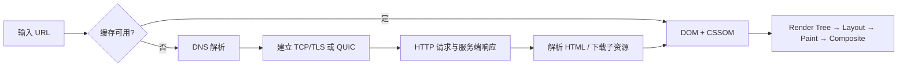

# 浏览器基本原理

## 面试开场：在浏览器输入 URL 后，发生了什么？

可以按“**缓存 → 解析 → 建连 → 请求 → 响应 → 渲染 → 交互**”来回答：

1. 浏览器先解析 URL，检查 Service Worker、HTTP 缓存、DNS 缓存等；命中可用的强缓存时，资源可以直接复用，不必发起网络请求。
2. 未命中缓存时，浏览器通过 DNS 将域名解析为 IP 地址；随后根据协议和端口建立连接。HTTPS 会在 TCP 连接之上完成 TLS 握手、校验证书并协商密钥；HTTP/3 则基于 QUIC/UDP。
3. 浏览器构造 HTTP 请求，携带请求行、请求头、Cookie 等信息，经 CDN、负载均衡、Nginx 等到达应用服务。服务端处理业务、查询缓存或数据库后返回 HTTP 响应。
4. 浏览器根据状态码、响应头处理重定向、压缩和缓存；拿到 HTML 后开始流式解析，同时发现并请求 CSS、JavaScript、图片等子资源。
5. HTML 解析生成 DOM，CSS 解析生成 CSSOM；两者结合生成渲染树。浏览器完成样式计算、布局（Layout）、绘制（Paint）和图层合成（Composite），最终把像素显示到屏幕。
6. JavaScript 可以修改 DOM 或 CSSOM，可能触发重新计算样式、回流或重绘；页面继续响应用户事件和后续异步请求。

> 面试时先用上面这段回答全链路，再按追问展开。不要把它说成严格串行：HTML 解析、子资源下载、样式计算和绘制会尽可能并行或增量进行。

## 1. 请求之前：URL、缓存与 DNS

### 1.1 URL 解析

浏览器会识别协议、主机、端口、路径、查询参数和锚点。例如 `https://example.com:443/a?x=1#top` 中：

- `https` 决定使用的协议；
- `example.com` 需要 DNS 解析；
- `443` 是端口（省略时使用协议默认端口）；
- `#top` 只在浏览器本地定位，不会发送给服务器。

### 1.2 HTTP 缓存

缓存能减少网络往返和资源下载。常见判断顺序是：先看强缓存，再在需要时协商缓存。

- **强缓存**：响应里的 `Cache-Control: max-age=...`（优先于 `Expires`）仍有效时，浏览器直接使用本地副本，通常不发请求。
- **协商缓存**：强缓存失效后，浏览器携带 `If-None-Match`（对应 `ETag`）或 `If-Modified-Since`（对应 `Last-Modified`）请求验证；内容未变时服务端返回 `304 Not Modified`，浏览器复用本地实体。
- HTML 通常应设置较短缓存或 `no-cache` 以便及时更新；带内容哈希的 JS、CSS、图片适合长缓存，例如 `Cache-Control: max-age=31536000, immutable`。

除 HTTP 缓存外，浏览器还可能命中 Service Worker、内存缓存、磁盘缓存以及 DNS 缓存。具体优先级由浏览器实现和资源类型决定。

### 1.3 DNS 域名解析

浏览器需要把域名解析为 IP。通常会依次尝试浏览器缓存、操作系统缓存、hosts 文件和本地递归 DNS 解析器；缓存都未命中时，递归解析器会向根域、顶级域（TLD）和权威 DNS 服务器查询，并将结果按 TTL 缓存。

DNS 并不一定使用 UDP：传统查询多用 UDP/53，较大响应或特殊场景会使用 TCP；现代环境也可能使用 DoH 或 DoT。

## 2. 建立连接并发送请求

### 2.1 TCP、TLS 与 HTTP

- **HTTP/1.1、HTTP/2** 通常运行在 TCP 之上。TCP 通过三次握手建立可靠的双向字节流；HTTP/1.1 默认可复用持久连接，HTTP/2 还能在一个连接中多路复用多个请求。
- **HTTPS**：TCP 建立后进行 TLS 握手，浏览器校验证书链和域名，协商协议版本、加密套件和会话密钥。之后 HTTP 报文才在加密通道中传输。
- **HTTP/3** 基于 QUIC（UDP），将传输层的可靠性、拥塞控制和 TLS 1.3 整合到 QUIC 中，可减少 TCP 层队头阻塞问题。

### 2.2 服务端处理

请求可能先经过 CDN、WAF、负载均衡和反向代理（如 Nginx）。静态资源可由 CDN 或 Nginx 直接返回；动态请求会被转发给应用服务，应用再访问缓存、数据库或其他服务，最后返回状态码、响应头和响应体。

常见状态码：`200` 成功、`301/302/307/308` 重定向、`304` 协商缓存命中、`401/403/404` 客户端相关错误、`5xx` 服务端错误。

## 3. 收到响应后：解析与渲染

### 3.1 HTML、CSS 与 JavaScript

浏览器会边下载边解析 HTML，构建 **DOM**；发现外部资源时会发起相应请求。

- CSS 被解析为 **CSSOM**。CSS 会影响渲染树，因此未完成的关键 CSS 会阻塞首次渲染。
- 普通 `<script>` 默认会阻塞 HTML 解析：浏览器下载并执行完它才继续解析，因为脚本可能修改文档。
- `defer` 脚本并行下载、在 HTML 解析完成后按出现顺序执行，并在 `DOMContentLoaded` 前完成。
- `async` 脚本并行下载，下载完成即执行，执行顺序不保证，适合相互独立的脚本。

### 3.2 从 DOM 到像素

浏览器渲染主流程：

1. 解析 HTML，生成 DOM；解析 CSS，生成 CSSOM。
2. 结合 DOM 和 CSSOM 计算每个可见节点的样式，生成渲染树（`display: none` 的节点不进入渲染树）。
3. **Layout / Reflow（布局/回流）**：计算各渲染对象的几何信息，如位置和尺寸。
4. **Paint（绘制）**：把文字、颜色、边框、阴影等绘制为绘制指令或位图。
5. **Composite（合成）**：将不同图层在合成线程/GPU 中组合并显示到屏幕。

`visibility: hidden` 的元素仍占据布局空间；`opacity: 0` 也会参与布局和绘制，只是最终不可见。这与 `display: none` 不同。

## 4. 页面生命周期与资源加载

- `document.readyState === 'loading'`：HTML 仍在解析。
- HTML 解析完成、`defer` 脚本执行完成后触发 `DOMContentLoaded`；此时 DOM 可安全访问，但图片等资源未必加载完。
- 所有依赖资源完成后，`readyState` 变为 `complete`，`window` 触发 `load` 事件。

图片、字体、CSS、JS 等子资源会受到连接数、优先级、协议和浏览器调度影响。HTTP/2/3 下不应再用 HTTP/1.1 的“每域名 6 个连接”来解释所有场景。

## 5. 回流、重绘与性能优化

### 回流（Reflow / Layout）

元素尺寸、位置或文档结构变化时，浏览器可能需要重新布局。例如修改 `width`、`margin`、文本内容、DOM 结构或视口尺寸。回流通常会带来后续绘制，成本通常高于单纯重绘。

### 重绘（Repaint）

只改变视觉外观、但不改变几何信息时，例如修改 `color`、`background-color`、`box-shadow`，通常只需要重绘。实际渲染路径仍取决于浏览器和属性，不能机械地认为所有属性都只触发一种阶段。

### 常用优化

- 批量读写 DOM：先读完布局信息，再集中修改样式，避免读写交替导致强制同步布局。
- 动画优先使用 `transform` 和 `opacity`，并用 `requestAnimationFrame` 安排逐帧更新。
- 减少复杂选择器、过大的 DOM 和频繁的布局查询，如 `offsetWidth`、`getBoundingClientRect()`。
- 通过代码分割、压缩、延迟加载、`preload`/`preconnect` 和合理缓存减少关键路径资源。

## 6. 高频追问

### 输入 URL 一定会 DNS 解析吗？

不一定。IP 地址、DNS 缓存、hosts、Service Worker 或 HTTP 缓存命中时，可能不需要新的 DNS 查询；重定向到新域名时则可能再次解析。

### `DOMContentLoaded` 与 `load` 的区别？

前者表示初始 HTML 已解析完成、延迟脚本已执行；后者表示图片、样式等页面依赖资源也已经加载完成。

### 回流一定会重绘吗？重绘一定会回流吗？

一般来说，布局变化会导致受影响区域需要重新绘制；仅视觉变化通常无需重新布局。浏览器会批处理和优化，实际范围以 DevTools 的 Performance/Rendering 面板测量为准。

### 详细阅读

[浏览器请求与渲染完整流程](../http-browser/01-浏览器请求-渲染的流程) ｜ [浏览器缓存](../http-browser/01-浏览器缓存) ｜ [TCP 三次握手](../http-browser/01-TCP-IP-握手) ｜ [回流与重绘](../http-browser/01-浏览器请求-渲染的流程#扩展-reflow-repaint)
