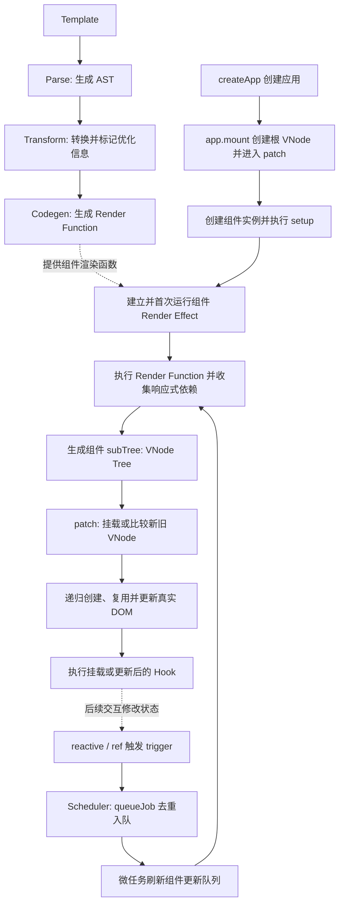
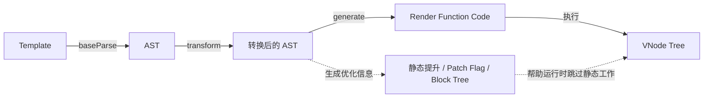
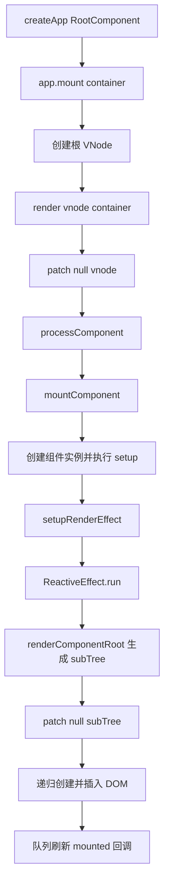
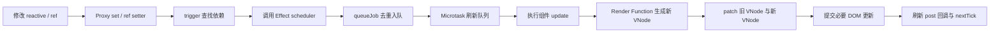

import Mermaid from '../../components/mermaid';
import CodeBlock from '../../components/codeBlock';

# Vue 3 原理总览

Vue 3 的核心目标是：把声明式模板转换成高效的 DOM 更新，并让状态变化能够自动找到需要重新计算的组件。

理解 Vue 3 可以抓住三部分：

| 模块 | 解决的问题 | 主要概念 |
| --- | --- | --- |
| Compiler | 模板如何变成可执行代码 | AST、Transform、Codegen、Render Function、静态提升、Patch Flag |
| Reactivity | 状态变化时，如何找到依赖它的计算 | `reactive`、`ref`、`track`、`trigger`、`ReactiveEffect` |
| Runtime | Render Function 的结果如何变成并更新 DOM | VNode、组件实例、Renderer、Patch、Scheduler、生命周期 |

三个模块连接起来就是：

```text
Template → Render Function → VNode → Patch → DOM
                          ↑
                 ReactiveEffect 追踪依赖
                          ↑
                 reactive / ref 状态
```

> Vue 2 主要通过 `Object.defineProperty` 拦截对象属性。本文以 Vue 3 为基线：响应式对象主要使用 Proxy，`ref` 使用带 getter/setter 的值容器。

## 客户端渲染完整流程（不使用 SSR）

参考 React 的“编译 → 执行渲染函数 → 虚拟节点 → 页面更新”顺序，Vue 3 的核心路径是：**模板编译为 Render Function，组件 Render Effect 执行它并收集依赖，得到 VNode，再由 Renderer 的 Patch 挂载或更新真实 DOM。** 状态变化后，Scheduler 会批量调度相关组件，重复执行渲染与 Patch。

<Mermaid>

</Mermaid>

### 1. 编译：Template → AST → Render Function

模板先经过 Parse、Transform 和 Codegen，生成创建 VNode 的 JavaScript 渲染函数，同时携带 Patch Flag、Block Tree 等优化信息。常见 `.vue` 单文件组件在构建时完成模板编译；使用包含编译器的 Vue 构建时，也可以在运行时编译模板。编译不会创建 DOM，也不会收集组件渲染依赖。

### 2. 首次挂载：创建组件实例与 Render Effect

`createApp(RootComponent)` 创建应用，`app.mount(container)` 创建根 VNode，并进入 `render` → `patch(null, vnode)`。遇到组件 VNode 时，Vue 创建组件实例、初始化 props 和 slots、执行 `setup`，准备渲染函数，再通过 `setupRenderEffect` 建立并首次运行组件的 Render Effect。

Render Effect 执行 `renderComponentRoot`，调用组件的 Render Function，得到组件的 VNode 子树 `instance.subTree`。渲染期间读取 `reactive` 属性或 `ref.value`，会建立“响应式数据 → 当前组件 Render Effect”的依赖连接；挂载时再通过 `patch(null, subTree)` 递归生成 DOM。

### 3. Patch：按 VNode 类型挂载或更新

VNode 是 UI 的轻量描述，常被称为虚拟 DOM；它不是模板 AST，也不是真实 DOM。Renderer 根据 VNode 的类型和 `shapeFlag` 等信息选择处理分支：

| VNode 类型 | 主要处理 | 与 DOM 的关联 |
| --- | --- | --- |
| 原生元素，如 `div` | `processElement`：挂载时创建元素、处理属性和子节点并插入；更新时复用元素并 Patch 差异 | 元素 VNode 的 `el` 指向对应 DOM |
| 组件 | `processComponent`：挂载时创建实例与 Render Effect；更新时按需更新 props、slots 和组件子树 | 通过 `vnode.component` 关联组件实例，再通过 `instance.subTree` 关联渲染结果 |
| 文本 | `processText`：创建文本节点或更新文本内容 | 文本 VNode 的 `el` 指向文本 DOM 节点 |
| Fragment | `processFragment`：挂载或更新一组子节点，不额外创建包裹元素 | 通过起止锚点表示对应的 DOM 范围 |

首次挂载没有旧 VNode，主要执行创建与插入；更新时则比较旧 `subTree` 与新 `subTree`，结合节点类型、`key` 和编译优化信息，复用 DOM 并执行必要的属性、文本、插入、移动和删除操作。

### 4. 状态更新：trigger → Scheduler → Render → Patch

修改响应式状态时，状态值立即改变，`trigger` 通知相关订阅者；组件的 scheduler 通常通过 `queueJob` 将更新任务去重入队。Scheduler 在微任务中刷新队列，重新运行组件 Render Effect，生成新 VNode，再 Patch 新旧子树。

因此，同一轮同步代码连续修改多次状态，组件更新通常会合并执行。依赖追踪用于找到需要更新的组件，Patch Flag / Block Tree 用于缩小动态节点的比较范围，Diff / Patch 则负责落实 DOM 变化。

### 5. 生命周期与 DOM 更新时机

首次挂载时，`onBeforeMount` 在组件首次渲染前执行，`onMounted` 在 DOM 插入后通过 post-render 队列执行；更新时，`onBeforeUpdate` 在本次渲染与 Patch 前执行，`onUpdated` 在 DOM 更新后通过 post-render 队列执行。模板 ref 也会随挂载、更新和卸载设置或清理，不能在 `setup` 中假定 DOM 已存在。

需要在状态修改后读取本批次更新后的 DOM，可以使用 `await nextTick()`。它等待当前调度批次完成，不负责触发更新，也不保证浏览器已经完成绘制。

### 与 React render / commit 的对应边界

Vue 的 VNode 在 UI 描述层面更接近 React Element。Vue 通过组件实例、Render Effect 和 VNode 子树组织更新，没有 React Fiber 的 `beginWork` / `completeWork` 流程，也没有相同的独立 commit 阶段：**Vue 在递归 Patch 时直接执行 DOM 操作。**

Vue 默认把组件更新调度到微任务中批处理，但一次普通组件的 Render / Patch 开始执行后，通常会同步执行完成；这种异步入队不等同于 React 并发 Render 的可中断与恢复。

## 一、模板编译：Template 如何变成 Render Function

Vue 模板不会直接交给浏览器执行。Compiler 会先把模板解析成 AST，再对 AST 做语义转换和优化，最后生成返回 VNode 的 Render Function。

<Mermaid>

</Mermaid>

### 1. Parse：生成 AST

Parser 读取标签、属性、文本、插值表达式和指令，将模板转换为结构化节点。例如：

<CodeBlock>
```vue
<button :class="{ active }" @click="count++">
  {{ count }}
</button>
```
</CodeBlock>

AST 会表达：这是一个 `button` 元素，它有动态 `class`、事件指令和动态文本子节点。此时还没有创建 DOM，也没有执行响应式依赖收集。

### 2. Transform：转换并标记优化信息

Transform 会遍历 AST，处理 `v-if`、`v-for`、`v-bind`、`v-on` 等语义，同时识别静态和动态部分。典型优化包括：

- **静态提升（Static Hoisting）**：把不会变化的节点或属性提到 Render Function 外，避免每次渲染都重新创建。
- **Patch Flag**：标记节点中会变化的部分，例如文本、class 或 style，让 Patch 不必逐项盲目比较。
- **Block Tree**：每个 Block 只收集动态后代，组件更新时可以直接遍历动态节点列表，而不是扫描完整 VNode Tree。

静态程度并不是简单的“静态 / 动态”二选一。编译器内部会根据节点、属性、子节点和表达式综合判断它能否跳过 Patch、能否提升或能否直接字符串化。

### 3. Codegen：生成 Render Function

以下是概念化结果，不对应某个 Vue 小版本的精确输出：

<CodeBlock>
```js
function render(ctx, cache) {
  return openBlock(), createElementBlock(
    'button',
    {
      class: normalizeClass({ active: ctx.active }),
      onClick: () => ctx.count++
    },
    toDisplayString(ctx.count),
    TEXT | CLASS
  );
}
```
</CodeBlock>

Render Function 的本质是普通函数：读取当前组件状态并返回 VNode。模板只是编写 Render Function 的声明式方式。

详细编译流程：

- [baseCompile 与 AST 转换](/vue/compiler-baseCompile)
- [Template 编译为 Render Function](/vue/compiler-render)
- [Codegen 生成代码](/vue/compiler-genCodeFn)

## 二、响应式：状态如何找到依赖它的组件

Vue 3 的响应式系统可以概括为“读取时订阅，修改时通知”：

1. 响应式数据被读取时执行 `track`，把当前正在运行的 Effect 记录为订阅者。
2. 响应式数据被修改时执行 `trigger`，找到订阅者并通知它们重新执行或进入调度队列。
3. 每个组件的渲染过程本身就是一个 Reactive Effect，因此 Render Function 读取的数据会成为该组件的渲染依赖。

### 1. `reactive`、`ref`、`track` 与 `trigger`

下面是省略边界处理后的概念伪代码：

<CodeBlock>
```js
let activeEffect;

function reactive(target) {
  return new Proxy(target, {
    get(target, key, receiver) {
      track(target, key, activeEffect);
      return Reflect.get(target, key, receiver);
    },
    set(target, key, value, receiver) {
      const result = Reflect.set(target, key, value, receiver);
      trigger(target, key);
      return result;
    }
  });
}

class ReactiveEffect {
  run() {
    activeEffect = this;
    const result = this.fn();
    activeEffect = undefined;
    return result;
  }
}
```
</CodeBlock>

实际依赖通常可以抽象为：

```text
WeakMap<target, Map<key, Set<ReactiveEffect>>>
```

这张依赖图与 VNode Tree 不同：依赖图回答“哪个 Effect 读取了哪个属性”，VNode Tree 回答“这一轮 UI 应该是什么结构”。

### 2. `computed`、`watch` 和 `watchEffect`

| API | 定位 | 依赖来源 | 是否应产生副作用 |
| --- | --- | --- | --- |
| `computed` | 缓存的派生状态 | 自动追踪 getter 中读取的响应式值 | 否，getter 应保持纯粹 |
| `watch` | 观察指定数据源并执行副作用 | 显式传入 ref、getter、reactive 对象或数据源数组 | 是 |
| `watchEffect` | 立即执行并自动追踪依赖的副作用 | 自动追踪同步执行期间读取的响应式值 | 是 |

`computed` 不等同于副作用：它描述“这个值如何由其他状态计算出来”。`watch` 和 `watchEffect` 才用于请求、日志、存储同步等外部操作。

详细响应式原理：

- [reactive 与 ReactiveEffect](/vue/reactiveAndEffect)
- [首次 track 与状态改变后的 trigger](/vue/trackDataTrigger)
- [computed 与 watch](/vue/computed)

## 三、首次挂载：从 `createApp` 到 DOM

首次挂载会创建根 VNode、组件实例和组件的 Render Effect，然后递归挂载 VNode Tree。

<Mermaid>

</Mermaid>

### 1. 根 Render 与 Patch

入口可以压缩成下面的概念代码：

<CodeBlock>
```js
function render(vnode, container) {
  if (vnode == null) {
    if (container._vnode) unmount(container._vnode);
  } else {
    patch(container._vnode || null, vnode, container);
  }

  container._vnode = vnode;
}

function patch(oldVNode, newVNode, container) {
  if (isElement(newVNode)) processElement(oldVNode, newVNode, container);
  else if (isComponent(newVNode)) processComponent(oldVNode, newVNode, container);
  else if (isText(newVNode)) processText(oldVNode, newVNode, container);
  // Fragment、Teleport、Suspense 等类型有各自的处理分支。
}
```
</CodeBlock>

`patch(null, vnode)` 表示挂载；`patch(oldVNode, newVNode)` 表示更新；新 VNode 为 `null` 时则进入卸载流程。

### 2. 组件 Render Effect

组件的渲染函数被包装成 Reactive Effect。首次 `run()` 既生成组件 SubTree，也会在读取响应式数据时完成依赖收集。

<CodeBlock>
```js
function setupRenderEffect(instance, container) {
  const componentUpdateFn = () => {
    if (!instance.isMounted) {
      const subTree = renderComponentRoot(instance);
      patch(null, subTree, container);
      instance.subTree = subTree;
      instance.isMounted = true;
    } else {
      const prevTree = instance.subTree;
      const nextTree = renderComponentRoot(instance);
      instance.subTree = nextTree;
      patch(prevTree, nextTree, container);
    }
  };

  const effect = new ReactiveEffect(componentUpdateFn);
  instance.update = () => effect.run();
  effect.scheduler = () => queueJob(instance.update);
  instance.update();
}
```
</CodeBlock>

这段代码同时解释了两个关键点：

- Render Function 执行期间读取状态，建立“状态 → 组件 Render Effect”的订阅。
- 后续状态变化不会直接反复操作 DOM，而是通过 Scheduler 把组件更新任务放入队列。

详细 Runtime 流程：

- [Render Function 执行与 VNode 构建](/vue/runtimeGenVnode)
- [VNode 创建后进入 Renderer](/vue/runtimeRender)

## 四、组件更新：从 `trigger` 到 Patch

<Mermaid>

</Mermaid>

### 为什么状态修改后不能立即读取最新 DOM？

Vue 会缓冲同一轮事件循环里的更新，并对组件任务去重。连续修改多次状态，通常只会触发一次组件更新：

<CodeBlock>
```js
count.value++;
count.value++;
count.value++;

// 此时响应式状态已经是新值，但 DOM 通常还没有刷新。
await nextTick();
// 当前批次的 DOM 更新已经完成。
```
</CodeBlock>

`nextTick` 不负责触发更新，也不等于 `setTimeout`。它返回与当前 Scheduler flush 相关的 Promise，用于等待本轮缓冲的 DOM 更新完成。

### 调度队列与执行时机

可以把一轮更新简化为三个阶段：

| 阶段 | 常见任务 | 访问 DOM 的含义 |
| --- | --- | --- |
| Pre Flush | 默认 `watch` 回调、组件更新前任务 | 当前组件 DOM 仍是更新前状态 |
| Component Jobs | 父子组件更新、Render 与 Patch | 计算并提交 DOM 变化 |
| Post Flush | `onUpdated`、`flush: 'post'` 的 watcher | 可以读取更新后的 DOM |

`flush: 'sync'` 会同步执行 watcher，应谨慎使用：它跳过批处理，频繁修改数组或状态时可能造成大量重复工作。

## 五、Diff 与编译器优化如何配合

响应式依赖追踪、编译优化和 Diff 分别处理不同层级的问题：

1. **依赖追踪**：决定哪些组件需要进入更新队列。
2. **Patch Flag / Block Tree**：帮助更新中的组件快速定位动态 VNode。
3. **Diff / Patch**：比较新旧 VNode，决定真实 DOM 如何复用、插入、移动或删除。

### 1. 普通节点 Patch

当新旧 VNode 类型和 `key` 一致时，Vue 会尽量复用对应 DOM，再根据 Patch Flag 或完整 props 对比更新属性和子节点。类型或 `key` 不一致时，旧节点会被卸载并挂载新节点。

### 2. Keyed Children

Vue 3 更新带 `key` 的列表时会先处理相同的头部和尾部，再处理未知中间区间。中间区间通过 key 建立新索引映射，并使用最长递增子序列减少不必要的 DOM 移动。

```vue
<li v-for="item in items" :key="item.id">
  {{ item.name }}
</li>
```

`key` 表示节点身份，而不只是消除警告。它应满足：

- 在兄弟节点中唯一。
- 在同一个业务项的多次渲染之间保持稳定。
- 优先使用数据 ID，避免随机数。
- 列表会插入、删除或重排时，避免使用数组下标作为 key。

详细 Diff：[Patch 与 Diff](/vue/patch-diff)，列表与 nextTick：[v-for、key 与 nextTick](/vue/v-for)。

## 六、生命周期与渲染时机

生命周期 Hook 不是独立于渲染流程的魔法，它们被安排在组件挂载、更新和卸载的特定位置：

| 阶段 | Composition API | 执行时机 |
| --- | --- | --- |
| 创建 | `setup` | 创建组件实例并初始化 props、slots 后执行；此时 DOM 尚未挂载 |
| 挂载前 | `onBeforeMount` | 首次 Render Effect 即将提交 DOM 前 |
| 挂载后 | `onMounted` | 组件 DOM 已创建并插入后，通过 post-render 队列执行 |
| 更新前 | `onBeforeUpdate` | 响应式依赖触发组件更新，Patch 旧 SubTree 前 |
| 更新后 | `onUpdated` | 新 SubTree 已 Patch 到 DOM 后，通过 post-render 队列执行 |
| 卸载前 | `onBeforeUnmount` | 组件仍可正常访问，准备停止其 Effect 前 |
| 卸载后 | `onUnmounted` | DOM、Render Effect 及组件相关 Effect 已停止后 |

父子组件的 Hook 还受递归 Patch 和调度顺序影响。业务代码不应依赖多个无关组件之间的偶然执行顺序；需要读取更新后 DOM 时优先选择 `onUpdated`、`flush: 'post'` 或 `await nextTick()`。

## 七、贯穿全流程的最小示例

<CodeBlock>
```vue
<script setup lang="ts">
import { computed, nextTick, ref, watchEffect } from 'vue';

const count = ref(0);
const doubled = computed(() => count.value * 2);

watchEffect(() => {
  console.log('当前 doubled：', doubled.value);
});

async function incrementThreeTimes() {
  count.value++;
  count.value++;
  count.value++;

  console.log('状态已更新，DOM 仍在等待 Scheduler 刷新');
  await nextTick();
  console.log('DOM 已完成本批次更新');
}
</script>

<template>
  <button @click="incrementThreeTimes">
    count: {{ count }}, doubled: {{ doubled }}
  </button>
</template>
```
</CodeBlock>

这个示例的完整执行链是：

1. Template 被编译成 Render Function，并为动态文本生成优化信息。
2. 首次执行 Render Function 时读取 `count` 和 `doubled`，组件 Render Effect 因此订阅它们。
3. `computed` 自己也有 Effect，并缓存 `count * 2` 的结果；`count` 不变时不会重复计算。
4. 连续三次修改 `count.value` 会触发依赖，但组件更新任务会去重。
5. Scheduler 在微任务中执行组件更新，生成新 VNode 并 Patch 动态文本。
6. `await nextTick()` 在本轮 DOM flush 完成后继续执行。

## 八、常见误区

### 1. “Vue 会监控所有 JavaScript 变量”

不会。只有通过 `reactive`、`ref` 等建立的响应式访问才能被追踪，普通局部变量的读写无法被 Proxy 或 getter/setter 拦截。

### 2. “reactive 对象不能重新赋值”

更准确地说：变量重新指向一个普通对象时，后续读取不会经过原 Proxy；旧 Proxy 的依赖关系也不会自动转移到新对象。

<CodeBlock>
```js
let state = reactive({ count: 0 });
state = { count: 1 }; // 新对象不是 reactive 返回的 Proxy

const stateRef = ref({ count: 0 });
stateRef.value = { count: 1 }; // ref setter 可以捕获整体替换
```
</CodeBlock>

从 reactive 对象直接解构基本类型也可能失去属性访问层面的响应式连接；需要保持连接时可使用 `toRef` 或 `toRefs`。

### 3. “computed、watch、watchEffect 都是副作用”

`computed` 是派生值，应该保持纯粹；`watch` 和 `watchEffect` 才用于副作用。能由现有状态计算出的值，不要再通过 watcher 复制成另一份 state。

### 4. “状态每改一次，DOM 就同步更新一次”

响应式状态会立即改变，但组件 DOM 更新默认会被调度和批处理。需要读取本批次更新后的 DOM 时使用 `nextTick` 或 post-flush API。

### 5. “有虚拟 DOM 就不需要考虑性能”

VNode Diff 仍然需要 CPU 和内存。错误的 key、超大的响应式对象、在模板中执行昂贵计算、无边界的大组件和不必要的深层 watcher 都会增加工作量。

## 九、性能与可维护性建议

- 使用 `computed` 缓存派生值，不要在模板中反复执行昂贵函数。
- 把更新频率和职责不同的 UI 拆成合理组件，使依赖追踪能缩小更新范围；不要为了拆分而制造过深层级。
- 大型不可变数据或外部状态可考虑 `shallowRef`、`shallowReactive` 或 `markRaw`，避免不需要的深层代理。
- 列表使用稳定业务 key；展示超大列表时还需要虚拟滚动，Diff 不能消除大量 DOM 本身的成本。
- 谨慎使用深层 `watch` 和 `flush: 'sync'`；副作用需要清理时使用 watcher cleanup 或作用域销毁机制。
- 先用 Vue DevTools、浏览器 Performance 和真实指标定位瓶颈，再使用 `v-memo`、浅响应式等针对性优化。
- SSR 时保证服务端和客户端首屏输出一致，避免随机值、时区差异和无效 HTML 造成 Hydration mismatch。

## 十、专题阅读顺序

1. [Compiler：baseCompile 与 AST](/vue/compiler-baseCompile)
2. [Compiler：生成 Render Function](/vue/compiler-render)
3. [Compiler：Codegen](/vue/compiler-genCodeFn)
4. [Reactivity：reactive 与 Effect](/vue/reactiveAndEffect)
5. [Reactivity：track 与 trigger](/vue/trackDataTrigger)
6. [Runtime：Render Function 与 VNode](/vue/runtimeGenVnode)
7. [Runtime：Renderer 与首次挂载](/vue/runtimeRender)
8. [Runtime：Patch 与 Diff](/vue/patch-diff)
9. [调度：v-for、key 与 nextTick](/vue/v-for)
10. [派生状态与副作用：computed、watch](/vue/computed)
