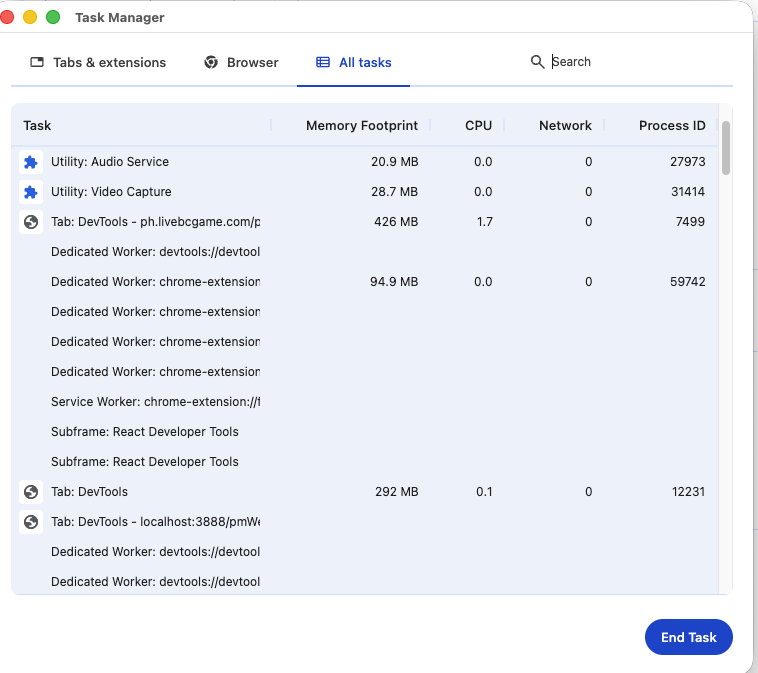

- Memory Footprint 430 MB：Chrome 给这个标签页/进程分配并占用的内存规模（包含渲染进程等，通常比 JS 堆大）。
- CPU 0.9：当前 CPU 使用率（大概 0.9% 左右），不高。
- Network 0：此刻没有网络吞吐。
- Process ID 7499：对应的系统进程号。

## Memory Footprint（内存）常见优化手段
- 减少常驻资源：大图/音频/视频按需加载与释放；不用的纹理/Buffer/对象置空并断引用。
- 降低 JS 堆与对象数量：避免频繁创建临时对象；复用数组/对象；用对象池（游戏/动画场景常用）。
- 避免内存泄漏：及时 removeEventListener、清理 setInterval/requestAnimationFrame、取消未完成的 fetch；注意闭包持有大对象；清理全局缓存/Map。
- 控制 DOM 规模：长列表虚拟滚动；减少隐藏但仍在 DOM 的节点；避免保留大量离屏元素。
- Worker / WebGL 管理：不用时 worker.terminate()；WebGL 资源显式 deleteTexture/deleteBuffer，切场景时清理。
- 缓存策略：避免把所有资源一次性常驻内存；区分“磁盘缓存(808MB)”与“内存缓存”，设置上限/淘汰策略。

## CPU（占用）常见优化手段
- 减少主线程工作量：重计算放到 Web Worker；拆分长任务（分帧处理），避免长时间阻塞。
- 动画/渲染降负载：优先用 requestAnimationFrame；降低帧率/分辨率；减少重绘与布局（layout/reflow）。
- 事件节流/防抖：滚动、mousemove、resize 等高频事件做节流；用 passive: true（不需要阻止默认时）。
- 减少无效循环：页面不可见时暂停（visibilitychange）；不需要时停止定时器/轮询。
- 网络与解析：减少巨型 JSON 解析、频繁 stringify；批量处理。
